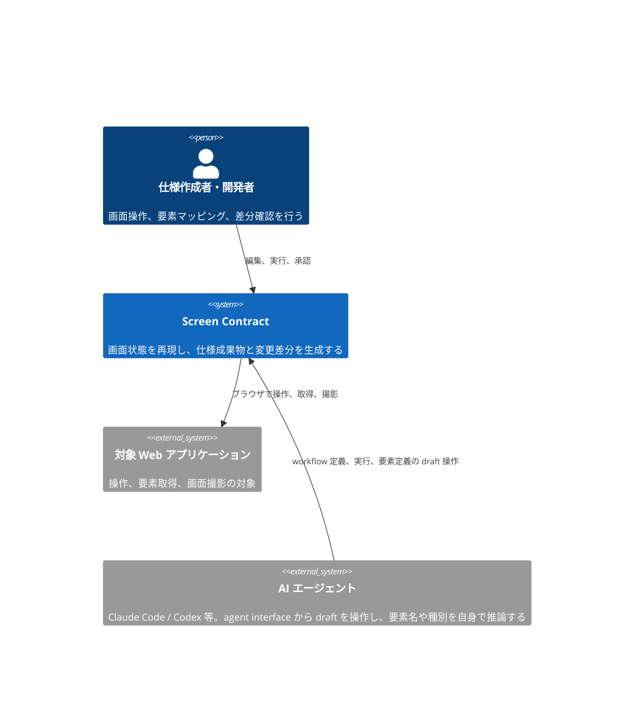

# Screen Contract PRD

## Overview / Problem Statement

Screen Contract は、ブラウザの上の画面状態と操作を DSL（ドメイン固有言語）で宣言し、再現できる形で実行する。  
利用者は Web UI で対象の画面を操作し、画面要素を選んで、永続的な要素 ID、構成番号、名称、種別、Locator を割り当てる。  
確定した DSL を元に、構成番号付きの画面画像、Markdown の構成要素テーブル、Playwright の Page Object のコードを生成する。

同じ DSL と同じ画面状態からは、同じ成果物を生成する。  
前回の Baseline との間に、構造、表示内容、配置、画像の差分があれば、差分を分類して示す。

Web UI は、DSL の実行をライブ映像とともに自動で再生し、ステップごとに対象の要素の注釈を重ねて表示する。  
利用者は再生を途中で止め、要素定義や構成番号を編集してから再開できる。

Screen Contract は AI ネイティブに設計する。  
AI エージェント（Claude Code、Codex など）は、人間用の Web UI と同じ use case を agent interface から操作する。  
AI エージェントは、workflow の定義、実行、要素定義を draft として自由に作って編集できる。  
人間の承認を要するのは、DSL の変更、構成番号、Baseline の更新の確定である。

画面仕様書を手で作るのは、画面への到達手順、期待状態、画面要素、構成番号、生成物の関係が、どこにも機械が読める形で残っていないためである。  
画像、Markdown、操作のスクリプトはそれぞれ別々に作られ、どれも元のデータになる。  
この関係を 1 つの機械が読めるモデルとして管理すれば、画面が変わったときに、どの仕様の項目に影響したかを追える。

## Background

### ブラウザ操作を記録するだけでは、操作と画面仕様の関係が残らない

ブラウザ操作をコマンドや一時的なスクリプトとして記録するだけでは、操作の対象、期待状態、操作の結果の関係が残らない。  
画面の構造や表示の文言が変わっても、どの仕様の項目に影響したかを追えない。

### 手で管理する画面仕様書は、画像と表と操作の手順がずれていく

画面仕様書を手で管理すると、次の問題が起きる。

- 画面画像と構成要素テーブルの番号が一致しなくなる。
- 画面を変えた後も、古い画像や要素定義が残る。
- 同じ要素へ、別々の構成番号や名称が割り当てられる。
- Selector が解決できなくなっても、仕様書を更新するまで気付かない。
- 画面状態を再現する操作が、担当者の手順に依存する。
- 画像、Markdown、操作のスクリプトが、それぞれ別の元のデータになる。

これらを防ぐには、画面への到達手順、期待状態、画面要素、構成番号、生成物の関係を、1 つの機械が読めるモデルとして管理する必要がある。

## Goals

対象の利用者は次の 2 者。

- 仕様作成者と開発者: 画面の操作、要素のマッピング、差分の確認を行う。
- AI エージェント: Claude Code、Codex など。agent interface から draft を操作し、要素の名称や種別を自身で推論する。

仕様作成者と開発者は、画面への到達手順と画面要素を DSL に定義し、DSL から画面仕様書の画像、表、Page Object を生成する。  
画面が変わったときは、変わった内容を種類ごとに分類して受け取る。  
AI エージェントは、人間の操作なしに DSL と要素定義の draft を作る。  
確定は、人間が承認したときにだけ行う。

## Lower-Priority Goals

次の項目は提供する価値があるが、MVP では優先しない。

- 操作の履歴から、再利用できる Page Object や Component Object を推論する。
- 既存の Playwright のコードとの統合の方式を定義する。
- 複数の実行環境で分散して実行する。
- 複数の利用者が同じ画面仕様を同時に編集し、競合を解決する。
- ドラッグ操作によるノードベースのワークフローの編集を提供する。
- 複数のブラウザで、同じ画面仕様を確かめる。
- CI（継続的インテグレーション）の上で、複数のブラウザを並列に実行する。
- CI で差分検知を実行し、レビューの対象の成果物を生成する。
- 仕様書の承認のワークフローを、外部のサービスと連携する。
- 画面仕様書の変更の承認の履歴を管理する。
- CI の上で差分検知を定期的に実行し、pull request と連携する。
- 画面仕様書を、PDF や HTML などの別の形式でも出力する。
- Page Object のコードを、Playwright のほかのフレームワーク向けにも出力する。
- AI エージェントの側の実装（Claude Code の skill や Codex の設定）を、利用者の文書で示す。

## Non-Goals

MVP では、次を意図して範囲の外にする。

- CAPTCHA や Bot 対策を回避する。
- 購入、決済、送信などの外部への副作用について、対象のシステムの協力なしに完全な冪等性を保証する。
- 任意の JavaScript やシェルのコマンドを、DSL から無制限に実行する。
- AI が利用者の承認なしに、Baseline や構成番号を確定する。
- 異なる OS、ブラウザ、フォントの環境の間で、ピクセル単位で同じ画像を保証する。
- 既存の文書管理システムの全体を置き換える。
- 対象の Web アプリケーションの API の仕様や業務の仕様を、自動で生成する。

## User Stories

### 仕様作成者が、画面を変えるたびに画像と表の番号を手で合わせ直している

画面画像と構成要素テーブルの番号は、手で管理すると一致しなくなる。  
画面を変えた後も古い画像や要素定義が残り、同じ要素へ別々の構成番号や名称が割り当てられる。  
How Might We: 画面画像と構成要素テーブルを、同じ定義から番号のずれなく作り直せるようにするには。

### 開発者が、Selector が解決できなくなったことに仕様書を更新するまで気付かない

画面の構造や文言が変わっても、どの仕様の項目に影響したかを追えない。  
How Might We: 画面が変わったときに、影響した要素と変更の種類を、仕様書を更新する前に知らせるには。

### 画面状態を再現する操作が、担当者の手順に依存している

How Might We: 誰が実行しても、同じ初期状態と入力から同じ画面状態へ到達できるようにするには。

### 利用者が、DSL から画面仕様書を作り、再実行で変更を確かめる（MVP）

利用者が果たしたい目的は、DSL から画面仕様書の成果物を作り、画面が変わったときに更新することである。  
一続きの操作は次のとおり。

1. 利用者が、対象の URL と画面状態への到達手順を DSL に定義する。
2. システムが DSL を検証し、各ステップを順に実行する。Web UI は、ライブ映像と実行中のステップを同期して表示する。
3. 利用者が再生を一時停止し、Web UI で画面要素を選ぶ。
4. システムか AI が、要素 ID、名称、種別、Locator の候補を示す。
5. 利用者が候補を承認して構成番号を確定し、再生を再開する。
6. システムが、注釈付きの画像、Markdown のテーブル、Playwright の Page Object のコードを生成する。
7. 再実行したときに前回の Baseline と比べ、変更の内容を分類して示す。
8. 変更のない成果物は書き換えず、変更のある成果物だけを更新の候補にする。

## Proposed Solution / Feature Description

### Landscape

利用者は Screen Contract で画面状態と要素定義を管理する。  
AI エージェントは人間と同じ use case を agent interface から操作するが、DSL の変更、構成番号、Baseline の更新を確定する承認は利用者だけが行う。  
対象の Web アプリケーションは元のデータを持たず、実行の対象として使う。

Screen Contract は外部の AI サービスへ接続しない。  
要素の名称や種別の推論は AI エージェント自身が行い、Screen Contract は LLM の認証情報を持たない。  
ADR-0019: [AI 候補生成をエージェント主導にする](adr/0019-agent-led-ai-suggestions.md)

### ワークフローの定義

- DSL の構文を定め、Schema で検証する。
- DSL を書く手段は、手書き、AI エージェント、操作の記録の 3 つにする。どの手段の出力も draft で、元のデータは DSL のまま変わらない。
  - ADR-0026: [操作の記録](adr/0026-operation-recording.md)

### 冪等な実行と再生

- ブラウザを操作し、宣言した状態を確かめてから変更する。期待状態を満たしている操作は再実行しない。
- ワークフローを自動で再生し、ステップ単位で一時停止し、再生の途中で要素定義を編集する。

### 画面要素の定義と採番

- 画面状態ごとに要素を定義する。
- 永続的な要素 ID と、表示用の構成番号を分けて管理する。
- Accessibility Snapshot と DOM の情報から、要素の候補を抽出する。
- AI が要素の名称、種別、Locator の候補を提案する。推論は AI エージェント自身が行い、Screen Contract は AI サービスへ接続しない。
  - ADR-0019: [AI 候補生成をエージェント主導にする](adr/0019-agent-led-ai-suggestions.md)

### 成果物の生成

- 構成番号付きの画像を生成する。
- Markdown の構成要素テーブルを生成する。
- Playwright の Page Object のコードを生成する。編集を禁じた生成物にする。
  - ADR-0006: [Playwright POM の出力](adr/0006-playwright-pom-output.md)

### 差分の検知

- 構造の差分、要素の差分、画像の差分を検知する。

### AI エージェントからの操作

- use case を、MCP server の tool として公開する。
- App Server 型 JSON-RPC で操作を受け、実行のイベントをストリームで配信する。

### Web UI と保存

- Web UI でライブの画面を表示し、操作を転送する。
- 操作の記録から、DSL の draft を作る。
  - ADR-0026: [操作の記録](adr/0026-operation-recording.md)
- Web UI で画面要素を選び、採番し、編集する。
- 実行の履歴と、生成した成果物を保存する。

### Milestones

#### MVP

提供する機能は、この節の上に挙げた機能の全部である。  
確かめる問いは、User Stories の「DSL から画面仕様書を作り、再実行で変更を確かめる」の一続きの操作を、通しで完了できるかである。  
Success Metrics のすべての条件を満たしたら、MVP を完了とする。

クラウドでの利用、チームでの利用、CI での実行は、MVP に含めない。

### Success Metrics

満たす条件は次のとおり。  
条件ごとの確認の方法は未定。

- 同じ初期状態と入力で同じ DSL を実行したとき、同じ期待状態へ到達する。
- 期待状態をすでに満たしている操作は再実行せず、変更なしとして記録する。
- 画面要素に、表示用の構成番号とは別に、永続的な要素 ID を付けられる。
- Web UI で画面要素を選び、名称、種別、構成番号、Locator を編集できる。
- DSL から、構成番号付きの PNG の画像と Markdown のテーブルを生成できる。
- DSL から、Playwright の Page Object のコードを決定的に生成できる。
- 生成する内容に意味の上での変更がないとき、既存の成果物を書き換えない。
- Locator の未解決、複数の一致、Role の変更、文言の変更、位置の変更、画像の変更を区別して検知できる。
- DSL の実行をステップ単位で自動で再生し、各ステップの対象の要素と検証の結果を、ライブ映像の上に注釈として表示できる。
- 再生を任意のステップで一時停止し、要素定義を編集した後に、そのステップから再開か再実行ができる。
- AI エージェントが agent interface から、DSL の作成、編集、実行と、要素定義の draft を、人間の操作なしに行える。
- AI による変更（要素名、種別、Locator、DSL の修正）は draft として扱い、DSL の変更、構成番号、Baseline の更新の確定は、人間が承認した後にだけ行う。
- 各実行について、入力、ステップの結果、Snapshot、スクリーンショット、差分の結果を追跡できる。

## Open Questions / Risks

### Open Questions

判断する人は未定。

- Success Metrics の条件ごとの確認の方法をどうするか。MVP の完了を判定する前に決める。
- ブラウザの実行基盤が、入力の転送でどこまでの操作の種類を扱えるか。`hover` と `scroll` の扱いが分かっていない。skeleton の実装で確かめる。
  - ADR-0026: [操作の記録](adr/0026-operation-recording.md)
- ブラウザの実行基盤が取得する Chrome for Testing のバージョンを、Screen Contract の側で固定できるか。固定できないと、ブラウザの更新で描画が変わり、画像の差分に出る。skeleton の実装で確かめる。
  - ADR-0027: [agent-browser の同梱](adr/0027-agent-browser-bundling.md)

### Risks

未定。
