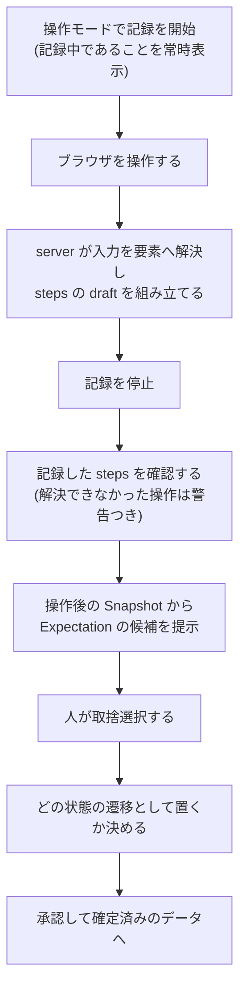
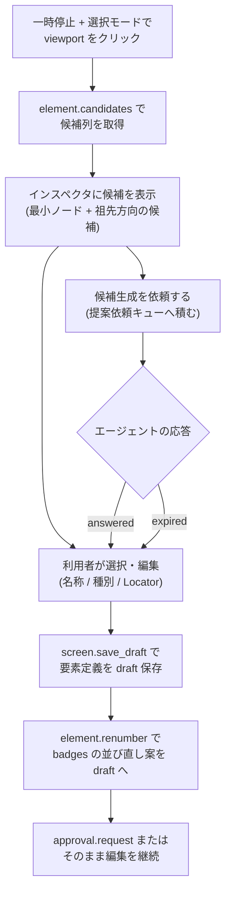
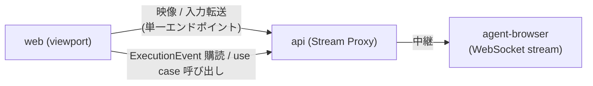

# Web UI

## Overview

Web UI は、人間の利用者が本システムを操作するための interface 層である。  
web はドメインロジックを持たず、すべての操作で api を通して app 層の use case を呼ぶ。  
呼ぶ use case は、AI エージェント向けの agent と同じものにする。  
層の分け方は [Design Doc](../../design/DesignDoc.md#components) にある。  
この文書の設計が満たす条件は [PRD の Success Metrics](../../PRD.md#success-metrics) にある。

framework は TanStack Start を使う。  
ADR-0001: [技術スタックを TypeScript monorepo にする](../../adr/0001-tech-stack.md)

live viewport は、agent-browser の dashboard を fork せず、配信と入力転送のパターンを参考にして自前で実装する。  
ADR-0015: [Web UI は dashboard の fork ではなく自前実装とする](../../adr/0015-web-ui-own-implementation.md)

## Scope

持つものは次のとおり。

- 画面構成（一覧、エディタ、承認キュー、差分ビュー）と、各画面の責務
- live viewport の表示と入力転送、選択モードと操作モードの切り替え
- 再生 UI（タイムラインと注釈）と、実行イベントとの同期の方法
- 要素選択から、候補の提示、draft への反映、再採番までの流れ
- 承認（DSL 変更、NumberingPlan、Baseline）と差し戻しの UI の流れ
- client の状態の持ち方

持たないものは次のとおり。

- use case とドメインロジック。app と core が持ち、web は呼ぶだけにする。
  - 層の責務は [Design Doc](../../design/DesignDoc.md#components) にある。
- HTTP と WebSocket のエンドポイントの定義。api が持つ。この文書は接続の構成だけを示す。
- 要素候補の解決の規則。[画面要素マッピング](../../packages/core-element/DesignDoc.md) が持つ。
- 差分の分類の規則。[変更差分検知](../../packages/core-diff/DesignDoc.md) が持つ。
- 認証の実装と、秘密情報の置き場。この文書は接続時の要件だけを示す。
  - 認証は [ローカル実行のセキュリティ](../../design/features/local-security/DesignDoc.md) が持つ。
  - 秘密情報の置き場は [operations.md](../../context/operations.md#secrets) が持つ。
- 視覚デザイン（配色、コンポーネントの見た目）

## Design

### 画面構成

画面ごとの責務は次のとおり。

| 画面                    | 責務                                                                                                                 |
| ----------------------- | -------------------------------------------------------------------------------------------------------------------- |
| Screens（一覧）         | Screen 文書の一覧、draft と確定済みの別、最後の実行の結果を表示する。ここからエディタを開く                          |
| Editor（エディタ）      | 中心の画面。live viewport、タイムライン、インスペクタの 3 つの領域を持つ                                             |
| Approvals（承認キュー） | 承認待ちの draft（DSL 変更、NumberingPlan、Baseline）を一覧し、承認と差し戻しを受ける                                |
| Diff（差分ビュー）      | DiffReport を表示する。要素の差分の表、画像の比較（Baseline、今回、ヒートマップ）、番号の対応表、mask を適用した領域 |

Editor の 3 つの領域は次のとおり。

- viewport（中央）: ライブ映像を出す。要素の bounding box と番号バッジを、UI のオーバーレイとして重ねて描く。
  - オーバーレイは表示のためだけに描き、保存しない。成果物の注釈画像とは別に扱う。
- タイムライン（下）: 実行のステップの列と、各ステップの結果（skipped、executed、failed）を出す。
  - 再生、一時停止、再開、ステップを指定した再実行を、ここで操作する。
- インスペクタ（右）: 選択中の要素の定義（名称、種別、Locator、note）を編集する。
  - 状態の切り替え、badges の並びの確認、要素候補の列の提示も、ここで行う。

### 再生 UI と実行イベントの同期

- web は、run の ExecutionEvent の列を api から購読し、イベントだけからタイムラインと注釈を更新する。
  - イベントに必要な情報を含める契約は、[冪等実行と再生制御](../../packages/core-execution/DesignDoc.md) が持つ。
- 巻き戻し（`rolled-back`）を受けたら、タイムラインの該当する区間を無効の表示に戻す。
- 切断したときは、カーソルを付けた取得で追いつく。
  - agent の [`run.events`](../../packages/agent/DesignDoc.md#mcp-でのイベント配信) と同じ仕組みを使う。
- 注釈は、現在のステップの対象要素と、検証した Expectation の結果を、bounding box とバッジで示す。

### 選択モードと操作モード

一時停止中のクリックには、2 つの意味がありうる。  
web は、明示のモードの切り替えでクリックを振り分け、暗黙には判定しない。

| モード             | クリックの意味                   | 実装                                                  |
| ------------------ | -------------------------------- | ----------------------------------------------------- |
| 選択モード（既定） | 要素の選択。実ページへ転送しない | 座標を `element.candidates` の query に使う           |
| 操作モード         | 実ページの操作。転送する         | 入力を Stream Proxy を通して agent-browser へ転送する |

選択モードの座標の query は、[冪等実行と再生制御](../../packages/core-execution/DesignDoc.md) の「座標 query は操作に含まない」に対応する。  
操作モードの入力の後、再開時に前提を検証し直すのは、[冪等実行と再生制御](../../packages/core-execution/DesignDoc.md) の責務である。

操作モードには、記録の入りと切りがあり、既定は切りにする。  
操作モードの主な用途は探索であり、探索のたびに steps が増えると draft が汚れるためである。  
ADR-0026: [操作の記録を DSL の draft を書く手段として提供する](../../adr/0026-operation-recording.md)

- 再生中（running）は、viewport への入力を受け付けず、閲覧だけにする。
  - モードの切り替えは、一時停止中だけ有効にする。
- 操作モードの間は、再開時に前提を検証し直すことを UI に明示する。
  - 利用者に知らせずに巻き戻さない。
- 選択モードで要素定義を編集したときも、同じ明示を出す。
  - 編集した run を再開すると、Workflow IR のバージョンが差し替わり、前提の再検証と巻き戻しが起きる。
  - 操作モードだけの注意にすると、編集による巻き戻しを利用者が予期できない。
  - ADR-0018: [再生中の要素定義編集を run 単位の IR version 固定で反映する](../../adr/0018-ir-version-pinning.md)

### 操作の記録から draft までの流れ

DSL を書けない利用者でも、画面仕様を起こせるようにする。  
利用者は、操作して、Expectation を選び、承認するだけで、確定済みの DSL を作れる。  
ADR-0026: [操作の記録を DSL の draft を書く手段として提供する](../../adr/0026-operation-recording.md)

次の図は、操作モードで記録を始めてから、承認して確定済みのデータにするまでの流れを示す。

UI の要点は次のとおり。

- 記録中であることを、常に表示する。
  - 利用者に知らせずに記録しない。停止も明示の操作にする。
- 一意な Locator へ解決できなかった操作は `clickPoint` として残り、UI は警告を出す。
  - 利用者は警告を無視して承認できる。UI は、脆い DSL になることを示す。
- Expectation を選ばずに承認できる点を、UI に明示する。
  - 選ばないと、期待状態を持たないステップになる。
  - そのステップは冪等スキップの対象にならず、毎回実行される。規則は [冪等実行と再生制御](../../packages/core-execution/DesignDoc.md) にある。
- 記録した steps をどの状態の遷移として置くかは、機械的に決まらないので、人が選ぶ。

### 要素選択から再採番までの流れ

次の図は、一時停止中に要素を選んでから、draft の保存と、badges の並び直しの案を作るまでの流れを示す。

候補生成は、人間が依頼を出し、エージェントが取りに来る pull 型にする。  
Web UI は、依頼を積み、その状態を表示する。  
ADR-0020: [人間起点の提案依頼を pull 型キューで実現する](../../adr/0020-suggestion-pull-queue.md)

依頼が `expired` になったら、手動で名付ける導線へ戻し、利用者を待ち続けさせない。  
AI がいなくても作業が完結することは本プロダクトの要件であり、UI がそれを担保する。

### 承認と差し戻し

- Approvals には、承認待ちの依頼が、由来（人間の編集、エージェントの依頼）を問わず並ぶ。
  - 対象は、DSL 変更、NumberingPlan、Baseline の更新の 3 種類。
- 承認の前に、対象の差分を必ず表示する。
  - DSL 変更はテキストの差分、NumberingPlan は番号の対応表、Baseline は DiffReport を表示する。
- 差し戻しには、構造化したコメントを付ける。
  - エージェント由来の依頼には、agent を通してコメントを返す。
  - 承認の流れの契約は、[AI エージェント操作](../../packages/agent/DesignDoc.md#承認依頼の流れ) が持つ。

### Stream Proxy の接続構成

次の図は、web が api の Stream Proxy だけに接続し、api が agent-browser の WebSocket のストリームを中継する構成を示す。

- web は、Workflow Server（api）の単一のエンドポイントだけに接続する。
  - agent-browser のポートには接続しない。
  - ADR-0008: [ライブ映像は Workflow Server 経由の Proxy で配信する](../../adr/0008-stream-proxy.md)
- 映像は、フレームの列を中継する。入力転送は、操作モードのときだけ逆向きに流す。
- **入力転送は、server の側でも検証する。**
  - Workflow Server は、対象の run が `paused` で、かつ操作モードであることを確かめてから中継する。
  - 対象の run が要求元のものでない入力も、中継せずに破棄する。
  - client の側の制御だけでは、認証を通したクライアントが Proxy へ直接送って迂回できる。
  - 破棄した入力は、イベントとして残す。
  - ADR-0008: [ライブ映像は Workflow Server 経由の Proxy で配信する](../../adr/0008-stream-proxy.md)

#### 接続時の認証

Web UI も、ローカルトークンを要求される。  
ブラウザはトークンのファイルを読めないため、Web UI は Workflow Server が配信する HTML に埋め込んだトークンを使う。  
受け渡しの方法と、URL の query に載せない規則は、[ローカル実行のセキュリティ](../../design/features/local-security/DesignDoc.md#接続ごとの認証) にある。  
ADR-0021: [agent interface の認可をループバック限定とローカルトークンで行う](../../adr/0021-agent-interface-authz.md)

#### 映像と重ね描きの対応付け

bounding box とバッジは、映像のフレームの上に重ねる。  
**フレームと Snapshot は別々に届くため、web は両者の対応を明示的に持つ。**

| 付ける情報                  | 用途                                          |
| --------------------------- | --------------------------------------------- |
| session と frame の識別子   | どの映像のフレームかを一意に決める            |
| viewport のバージョンと寸法 | 座標系が変わったフレームへ古い box を重ねない |
| Snapshot が対応する frame   | 重ね描きしてよい組み合わせを判定する          |

対応が取れない組み合わせは、描画しない。  
対応を持たないと、フレームの欠落や到着の順の入れ替わりで、別の画面に box を重ね、誤った要素を選択させる。  
座標の query も同じ理由で、対応の取れたフレームからだけ発行する。

### client の状態の持ち方

- DSL、Baseline、実行の履歴は、client に持たない。
  - 表示に使うデータは、すべて api から取得し直せる。
  - 規則は [codebase.md の State Ownership](../../context/codebase.md#state-ownership) にある。
- client が持つのは、表示の状態だけにする。
  - 選択中の要素、モード、タイムラインのスクロールの位置のように、再読み込みで失われてよいものに限る。
- 編集中の未保存の入力は、フォームの中の一時的な状態にする。
  - 保存（`save_draft` による draft への反映）は、明示の操作にする。

## Interface

### 画面の URL

URL は、`screen`、`state`、`run` を表す。  
利用者は、再読み込みしても同じ文脈に戻れる。

### チェック

テストの共通の規約は [context/testing.md](../../context/testing.md) にある。  
web の unit test は、表示のロジックのうち純粋な部分に絞る。  
この機能に固有の観点は次のとおり。

- イベントからタイムラインと注釈を作る reducer: 同じイベントの列から同じ表示の状態になること（決定性）と、`rolled-back` の巻き戻しの表示
- オーバーレイの座標の変換: viewport の表示の倍率、clip、スクロールに対する bounding box の写像
- モードの切り替え: 選択モードでクリックが転送されないことと、再生中に入力が無効なこと
- 承認の流れ: 差分を表示しないと承認のボタンを押せないことと、差し戻しのコメントが伝わること
- 切断と再接続: イベントを取りこぼさずに表示が追いつくこと
