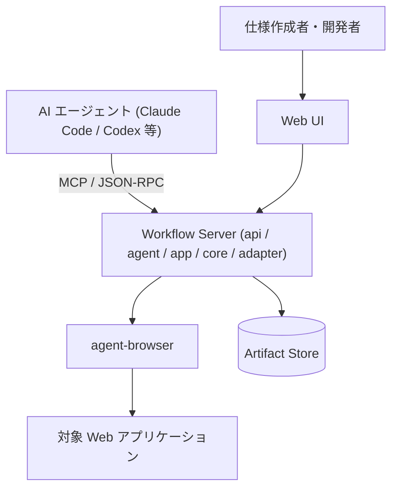
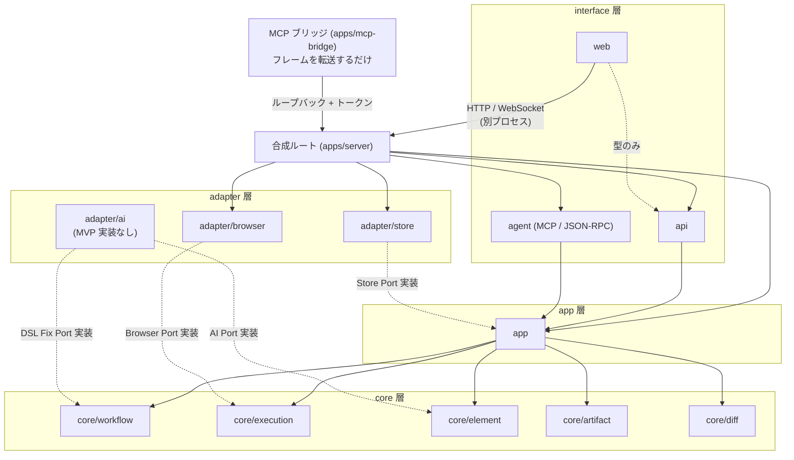

# Screen Contract Design Doc

## Overview

Screen Contract は、ブラウザの上の画面状態と操作を DSL で宣言し、再現できる形で実行する。  
確定した DSL から、構成番号付きの画面画像、Markdown の構成要素テーブル、Playwright の Page Object のコードを生成し、Baseline との差分を分類する。  
使うのは、Web UI を操作する仕様作成者と開発者と、agent interface を操作する AI エージェントである。  
誰のどの課題を解くかは [PRD](../PRD.md) にある。

ブラウザの操作は agent-browser に任せ、agent-browser を実行の adapter として扱う。  
agent-browser のコマンドの列だけでは、操作の目的、期待状態、画面仕様の上の要素 ID、構成番号、変更の差分の意味を表せない。  
そのため、agent-browser の上に DSL と Workflow IR を置く。  
ADR-0013: [ブラウザ実行基盤に agent-browser を使う](../adr/0013-agent-browser-runtime.md)

実装は TypeScript の monorepo にし、Workflow Server、Web UI、MCP ブリッジの 3 つのプロセスで組む。  
ADR-0001: [技術スタック](../adr/0001-tech-stack.md)

## Goals and Non-Goals

### Goals

- DSL を、画面の操作と画面の仕様の唯一の元のデータにする。画像、Markdown のテーブル、実行のスクリプトは DSL から生成し、個別に編集しない。
  - ADR-0011: [DSL を唯一の元のデータにする](../adr/0011-dsl-as-source-of-truth.md)
- 同じ DSL と同じ画面状態から、同じ成果物を生成する。
- 人間用の Web UI とエージェント用の agent interface が、同じ app 層の use case を呼ぶ。操作の範囲の差は、人間の承認を要するかどうかだけにする。
  - ADR-0017: [エージェントの操作範囲を draft までにする](../adr/0017-agent-draft-boundary.md)
- 次の拡張を、モジュールの追加か差し替えで実現できるようにする。
  - ブラウザの実行基盤の差し替え（Browser Port の別の実装）
  - AI サービスの差し替え（AI Port の別の実装）
  - 保存の方式の差し替え（Store Port の別の実装）
  - CLI と CI での実行の追加（app 層が interface に依存しないため、interface の追加で対応する）
  - ADR-0014: [core を機能単位に分け Ports and Adapters を採る](../adr/0014-core-split-ports-adapters.md)

### Non-Goals

- 外部の AI サービスへの接続と、LLM の認証情報の保持。要素の名称と種別の推論は AI エージェントが行う。
  - ADR-0019: [AI 候補生成をエージェント主導にする](../adr/0019-agent-led-ai-suggestions.md)
- Web UI の側の server の機能に API のロジックを置くこと。Workflow Server の api 層を唯一の backend にする。
  - ADR-0001: [技術スタック](../adr/0001-tech-stack.md)
- agent-browser の組み込みの dashboard を fork すること。Web UI は、live viewport の配信と入力の転送の形を参考にして自前で作る。
  - ADR-0015: [Web UI を自前で実装する](../adr/0015-web-ui-own-implementation.md)
- Workflow Server をリモートに公開すること。Workflow Server は 127.0.0.1 にだけ bind する。
  - ADR-0021: [agent interface の認可](../adr/0021-agent-interface-authz.md)

## Assumptions and Constraints

### 実行の前提

- MVP で実行するブラウザは、agent-browser が対応する Chromium 系のブラウザにする。
- 利用者は agent-browser を直接入れず、直接操作しない。agent-browser は Screen Contract が同梱し、adapter/browser が管理する内部の実装である。
  - 利用者の接点は、DSL、Web UI、agent interface に限る。
  - 利用者の資産（DSL、仕様書、POM）は、実行基盤に依存しない語彙で書く。Browser Port の別の実装で実行基盤を差し替えても、資産は引き継がれる。
  - ADR-0027: [agent-browser の同梱](../adr/0027-agent-browser-bundling.md)
- 対象の画面は、確かめられる開発環境かテスト環境で起動できる。
- 動的なデータは、Fixture、Mock、固定の入力のどれかで再現できるようにする。
- ライブ映像の配信には、agent-browser の WebSocket のストリーミング（JPEG のフレームと入力の転送）を使う。
  - ADR-0008: [ライブ映像を Workflow Server 経由で配信する](../adr/0008-stream-proxy.md)

### DSL と要素の前提

- DSL は YAML で書き、Schema で検証する。
- DSL を書く手段は、手書き、エージェント、操作の記録の 3 つにする。どの手段の出力も draft で、元のデータは DSL のまま変わらない。
  - ADR-0026: [操作の記録](../adr/0026-operation-recording.md)
- 実行系は YAML を直接扱わず、core/workflow が正規化した Workflow IR を使う。
- 要素の同一性には永続的な要素 ID を使い、構成番号を識別子に使わない。
  - ADR-0012: [永続要素 ID と構成番号を分ける](../adr/0012-element-id-number-separation.md)
- agent-browser の一時的な要素の参照は、DSL へ保存しない。
- Locator は、Role、Accessible Name、Label、Test ID などの Semantic Locator を優先する。

### 承認と秘密情報の前提

- AI の出力とエージェントの操作は、構造化した draft として扱う。DSL の変更、構成番号、Baseline の更新の確定は、人間の承認を経る。
- 認証情報は、DSL、ログ、Snapshot、生成した成果物へ平文で保存しない。

## Architecture

誰が何のために使うかの L1 の図は、[PRD の Landscape](../PRD.md#landscape) にある。  
次の図は、主要な実行の単位とデータの流れを示す。



Web UI は編集と確認を担い、ブラウザの操作と成果物の生成を直接実行しない。  
Workflow Server は DSL、Workflow IR、Baseline を管理し、実行、候補の生成、成果物の生成、差分の検知を調停する。

動くものと起動のしかたは次のとおり。  
配布物は 1 つの Node のパッケージである。

| 動くもの        | 実体              | 起動のしかた                                          |
| --------------- | ----------------- | ----------------------------------------------------- |
| Workflow Server | `apps/server`     | 利用者が起動する常駐のプロセス。127.0.0.1 にだけ bind |
| Web UI          | `apps/web`        | Workflow Server が配信する静的なファイル              |
| MCP ブリッジ    | `apps/mcp-bridge` | AI エージェントが stdio で起動する                    |
| agent-browser   | 外部の CLI        | Workflow Server が子プロセスとして起動する            |

プロセスの境界の取り決めは [context/codebase.md](../context/codebase.md#module-boundaries) にある。

## Components

### 層の分け方

モジュールは interface、app、core、adapter の 4 つの層に分け、どの層にも入らない合成ルートを 1 つ置く。

- interface 層（web、api、agent）は、利用者とエージェントとの接点だけを持ち、ドメインのロジックを持たない。
  - 人間用とエージェント用の interface は同じ app 層の use case を呼び、操作の範囲の差は、人間の承認を要するかどうかだけにする。
- app 層は、複数の core を結線して use case を編成する。ドメインのロジックを持たない。
  - adapter へは依存せず、Port の実装を合成ルートから受け取る。
- core 層は機能単位に分け、機能ごとのドメインのモデル、ドメインのロジック、Port の定義を持つ。core 同士は型の参照のほかに依存しない。
- adapter 層は Port を実装し、外部の技術に固有の処理を閉じ込める。
- 合成ルートは、adapter の具象を選んで app へ注入し、プロセスを起動する。adapter を知る唯一の場所である。
  - ADR-0023: [合成ルート](../adr/0023-composition-root.md)

Port は、原則としてそれを使う core が定義する。  
保存だけは機能をまたぐため、Store Port を app 層で定義する。  
ADR-0014: [core を機能単位に分け Ports and Adapters を採る](../adr/0014-core-split-ports-adapters.md)

### core 層

| モジュール     | 責務                                                                                                                                 | 定義する Port |
| -------------- | ------------------------------------------------------------------------------------------------------------------------------------ | ------------- |
| core/workflow  | DSL の Schema の検証、Workflow IR への正規化、バージョンの互換性の定義                                                               | DSL Fix Port  |
| core/execution | ステップの実行のルール、期待状態の検証、冪等スキップの判定、再生の制御（一時停止、再開、ステップ単位の再実行）、実行のイベントの発行 | Browser Port  |
| core/element   | 永続要素 ID、Locator のモデル、構成番号の採番の規則、要素の候補の正規化（Snapshot と DOM の生のデータは入力として受け取る）          | AI Port       |
| core/artifact  | 注釈の画像、Markdown のテーブル、Playwright の POM のコードの決定的な生成、意味の上での変更がないときの書き換えの抑止                | なし          |
| core/diff      | Baseline との比較、構造の差分、要素の差分、画像の差分の分類                                                                          | なし          |

### interface と app と adapter の層

| モジュール      | 責務                                                                                                                     | 実装と依存                                              |
| --------------- | ------------------------------------------------------------------------------------------------------------------------ | ------------------------------------------------------- |
| web             | DSL の編集、ライブの表示、再生の制御（一時停止と再開）、要素の選択、採番、差分の承認                                     | api に依存する                                          |
| api             | HTTP API、WebSocket、認可                                                                                                | app に依存する                                          |
| agent           | MCP server と App Server 型 JSON-RPC による use case の公開、実行のイベントのストリームの配信、エージェントの操作の認可  | app に依存する                                          |
| app             | use case の編成（実行、要素の編集、成果物の生成、差分の承認）、提案依頼キューの保持、外部の入力の検証、Store Port の定義 | 各 core に依存する。adapter と interface へは依存しない |
| domain          | 全部の core が共有する型の定義。実行時の値を持たない                                                                     | 何にも依存しない                                        |
| MCP ブリッジ    | stdio とループバックの間で JSON-RPC のフレームを転送し、トークンを付ける。tool の語彙を解釈しない                        | 何にも依存しない                                        |
| adapter/browser | agent-browser の起動、操作、Snapshot とスクリーンショットの取得、ライブの配信                                            | Browser Port を実装する                                 |
| adapter/ai      | 要素の名称、種別、Locator、DSL の修正の候補の構造化した取得。MVP では実装しない                                          | AI Port と DSL Fix Port を実装する                      |
| adapter/store   | DSL、Baseline、Snapshot、画像、ログ、差分の結果の保存                                                                    | Store Port を実装する                                   |
| 合成ルート      | adapter の具象を選んで app へ注入する。api と agent を 1 つのプロセスに載せる。起動と終了を管理する                      | 全部の層に依存してよい                                  |

MCP ブリッジの転送の範囲は [ローカル実行のセキュリティ](features/local-security/DesignDoc.md#mcp-ブリッジが転送してよい範囲) にある。  
ADR-0021: [agent interface の認可](../adr/0021-agent-interface-authz.md)

adapter/ai を MVP で実装しないのは、AI の候補の生成をエージェントが主導するためである。  
ADR-0019: [AI 候補生成をエージェント主導にする](../adr/0019-agent-led-ai-suggestions.md)

### 依存の向き

次の図は、層とモジュールの間の依存を示す。  
実線は実装への依存、破線は Port の型だけへの依存である。



依存の向きは interface から app、app から core にする。  
adapter は、自身が実装する Port の定義元へ、型を通じてだけ依存する。  
agent-browser と保存の方式に固有の処理は、adapter の中に閉じ込める。

web と MCP ブリッジは、合成ルートへ依存しない。  
どちらも別のプロセスとして起動し、HTTP と WebSocket か、stdio でつなぐ。

adapter を知るのは合成ルートだけである。  
app が adapter へ依存すると、Store Port が app にあるため循環し、テストのときの fake の差し替えが実行時の分岐になる。  
ADR-0023: [合成ルート](../adr/0023-composition-root.md)

依存の規則と、規則を確かめる手段は [context/codebase.md](../context/codebase.md#dependency-rules) にある。

### 機能ごとの設計

機能ごとの設計は core のモジュールと 1 対 1 に対応させる。  
interface と adapter に固有の設計は、それを使う機能の文書か、専用の文書に置く。

- [ワークフロー定義](../packages/core-workflow/DesignDoc.md): core/workflow
- [冪等実行と再生制御](../packages/core-execution/DesignDoc.md): core/execution と adapter/browser
- [画面要素マッピング](../packages/core-element/DesignDoc.md): core/element
- [仕様成果物生成](../packages/core-artifact/DesignDoc.md): core/artifact
- [変更差分検知](../packages/core-diff/DesignDoc.md): core/diff
- [Web UI](../apps/web/DesignDoc.md): web
- [AI エージェント操作](../packages/agent/DesignDoc.md): agent と MCP ブリッジ
- [AI 候補生成](features/ai-suggestions/DesignDoc.md): adapter/ai。MVP では実装しない
- [ローカル実行のセキュリティ](features/local-security/DesignDoc.md): Workflow Server への接続の認証、認証状態と secret の暗号化

## Interfaces

利用者の接点は、DSL、Web UI、agent interface の 3 つである。

- DSL: Screen 文書と Workflow 文書の 2 種類の YAML。構造は [ワークフロー定義](../packages/core-workflow/DesignDoc.md) にある。
  - ADR-0003: [DSL の構造](../adr/0003-dsl-structure.md)
- Web UI: Workflow Server が配信する。画面の構成は [Web UI](../apps/web/DesignDoc.md) にある。
- agent interface: MCP server と App Server 型 JSON-RPC。tool の語彙は [AI エージェント操作](../packages/agent/DesignDoc.md) にある。
  - ADR-0016: [MCP と App Server 型 JSON-RPC の両方を採る](../adr/0016-dual-agent-protocol.md)

利用者が受け取る成果物は、構成番号付きの画像、Markdown の構成要素テーブル、Playwright の Page Object のコード、差分のレポートである。  
形式と置き場は [仕様成果物生成](../packages/core-artifact/DesignDoc.md) と [変更差分検知](../packages/core-diff/DesignDoc.md) にある。

利用者の環境に置くローカルの状態は、[ローカル実行のセキュリティ](features/local-security/DesignDoc.md#interface) にある。

## Cross-Cutting Concerns

### 判断の優先順位

設計で迷ったときは、次の順に優先する。

1. 再現性と決定性（同じ入力から同じ成果物）
2. AI ネイティブ（エージェントから操作できること）
3. 拡張性（Port による差し替えができること）
4. 開発体験
5. パフォーマンス

### draft と確定

エージェントと利用者の編集は draft に置き、確定済みのデータへは人間の承認を経て反映する。  
確定の対象は、DSL の変更、構成番号、Baseline の更新の 3 つである。  
規則は [draft と確定](../context/domain/draft-and-confirmation.md) にある。  
ADR-0017: [エージェントの操作範囲を draft までにする](../adr/0017-agent-draft-boundary.md)

### 秘密情報

認証情報、Storage State、DSL が参照する secret の値を、DSL、ログ、Snapshot、生成した成果物へ平文で出さない。  
置き場と置かない場所は [context/operations.md](../context/operations.md#secrets) に、暗号化と接続の認証は [ローカル実行のセキュリティ](features/local-security/DesignDoc.md) にある。

## Repository Layout

```text
.
├── PRD.md
├── design/
│   ├── DesignDoc.md         # この文書
│   └── features/            # コードを持たない機能の設計（ai-suggestions、local-security）
├── adr/                     # ADR
├── context/                 # 規約と事実
├── apps/                    # デプロイの単位。ほかのパッケージから依存されない
│   ├── server/              # 合成ルートと bin。adapter の具象を選ぶ唯一の場所
│   ├── web/                 # Web UI（TanStack Start の SPA）。DesignDoc.md を含む
│   └── mcp-bridge/          # stdio とループバックの間の転送
├── packages/                # 内部のモジュール。デプロイの単位にならない
│   ├── domain/              # 全部の core が共有する型だけ
│   ├── core-*/              # workflow、execution、element、artifact、diff。それぞれ DesignDoc.md を含む
│   ├── app/                 # use case と Store Port
│   ├── adapter-*/           # browser、store（ai は MVP で実装しない）
│   ├── api/                 # Hono のアプリケーションの factory（listen しない）
│   ├── agent/               # MCP と JSON-RPC と共通のマッピング層。DesignDoc.md を含む
│   ├── fixture-app/         # テストが操作する対象アプリ
│   └── config/              # tsconfig と vitest の共有の設定
├── e2e/                     # Playwright。server をプロセスとして起動する
├── hooks/                   # Git のフックのスクリプト
└── scripts/
```
