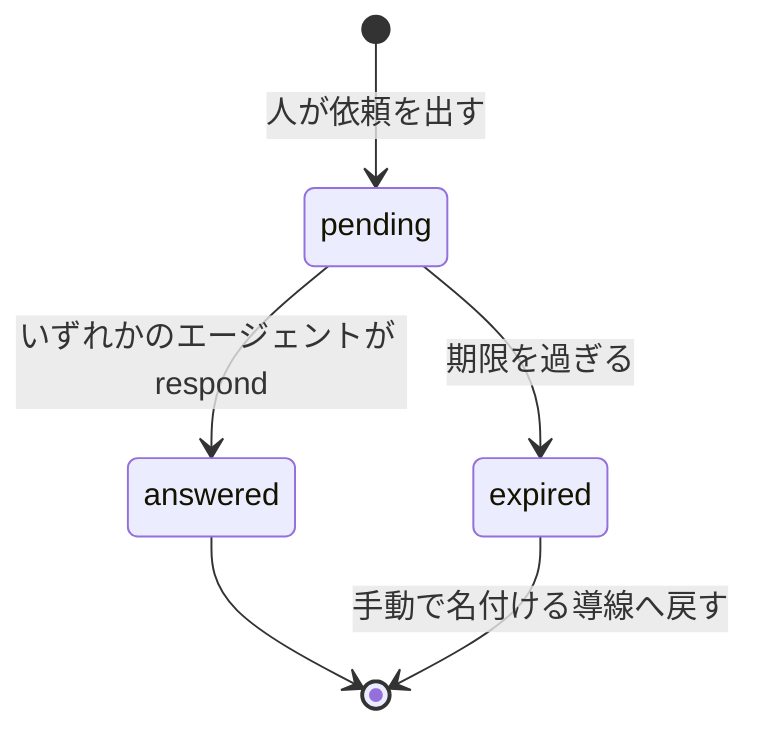
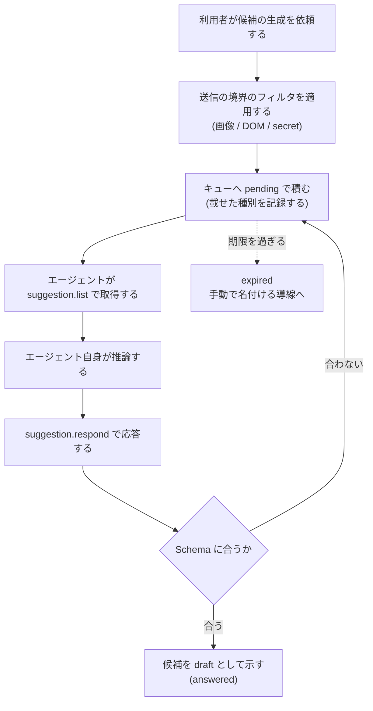

# AI 候補生成

## Overview

AI 候補生成は、要素の名称、種別、Locator の候補と、DSL の修正の候補を AI に作らせる機能である。

推論はエージェント自身が行う。  
このプロダクトは AI サービスへ接続せず、credential も持たない。  
利用者が使っている Claude Code や Codex が、agent interface を通して依頼を取りに来て、推論の結果を draft として書き戻す。  
ADR-0019: [AI 候補生成をエージェント主導にする](../../../adr/0019-agent-led-ai-suggestions.md)

この文書は次の 2 つを定める。

- 依頼の受け渡し。人が出した依頼を、エージェントがどう受け取り、どう返すか。
- 送る情報の境界。依頼にどこまでの情報を載せてよいか。

AI がいなくても、機能は完結する。  
候補の生成は、機械的な候補の抽出（core/element）を補うもので、本体の機能の前提にしない。  
満たす成功の条件は [PRD の Success Metrics](../../../PRD.md#success-metrics) にある。  
全体の構成は [Design Doc](../../DesignDoc.md#components) にある。

## Scope

持つものは次のとおり。

- 提案依頼キューのデータモデルと状態遷移
- 依頼に載せる情報の境界（送信の境界）と、その記録
- 応答のチェックと、draft への反映の原則

持たないものは次のとおり。

- tool の Schema と認可。[エージェントの interface](../../../packages/agent/DesignDoc.md) が持つ。
- 依頼を出す UI と、`expired` のときの導線。[Web エディタ](../../../apps/web/DesignDoc.md) が持つ。
- 機械的な候補の抽出の規則と、AI Port の契約。[画面要素マッピング](../../../packages/core-element/DesignDoc.md) が持つ。
- DSL Fix Port の契約。[ワークフロー定義](../../../packages/core-workflow/DesignDoc.md) が持つ。
- 外部の AI サービスへの接続（provider の抽象と credential の解決）。MVP では実装しない。
  - AI Port と DSL Fix Port は型だけを持ち、MVP では実装しない。
  - ADR-0019: [AI 候補生成をエージェント主導にする](../../../adr/0019-agent-led-ai-suggestions.md)

## Design

### 提案依頼キュー

人が依頼を積み、エージェントが取りに来る pull 型にする。  
キューは app 層が持つ。  
ADR-0020: [人間起点の提案依頼を pull 型キューで実現する](../../../adr/0020-suggestion-pull-queue.md)

| 項目       | 内容                                                                |
| ---------- | ------------------------------------------------------------------- |
| 依頼の識別 | 依頼 ID（サーバが発行する）                                         |
| 対象       | Screen と state、対象の要素候補（画面要素マッピングが抽出したもの） |
| 種別       | 要素の命名か、DSL の修正か                                          |
| 入力       | 送信の境界を適用した後の情報（「送る情報の境界」の節）              |
| 状態       | `pending`、`answered`、`expired`                                    |
| 期限       | 依頼ごとに持つ。過ぎたら `expired`                                  |
| 応答       | 構造化した候補の列。自由な文を受け取らない                          |

次の図は、依頼の状態遷移を示す。

依頼を特定のエージェントへ排他的に割り当てない。  
複数のエージェントが同じ依頼を取り出してよい。  
応答は複数の draft として並び、人が選ぶ。  
ADR-0020: [人間起点の提案依頼を pull 型キューで実現する](../../../adr/0020-suggestion-pull-queue.md)

`expired` を必ず持つ。  
応答がないまま待ち続けさせないためである。  
AI がいなくても完結するという要件は、この状態遷移で守る。

### 送る情報の境界

依頼の内容は、エージェントを通してモデルの提供者のサーバへ送られる。  
プロセスがローカルであることと、データがローカルに留まることは別である。  
ADR-0010: [AI サービスへの送信の境界](../../../adr/0010-ai-data-boundary.md)

| 送る内容                                                                        | 既定     | 変え方                             |
| ------------------------------------------------------------------------------- | -------- | ---------------------------------- |
| Snapshot の断片（対象の要素と周りの文脈）、画面のメタ情報、既存の要素定義の一覧 | 送る     | 常に送る（依頼の入力）             |
| スクリーンショットの画像                                                        | 送らない | プロダクトごとの設定で明示的に許す |
| DOM の断片                                                                      | 送らない | プロダクトごとの設定で明示的に許す |
| secret の系統のフィールド（パスワードなど）の値                                 | 取り除く | 変えられない（常に取り除く）       |

- フィルタは、依頼をキューへ積む直前に、1 か所で適用する。
  - 依頼を作る側が、個別に判断しない。
- 何をどの種別で載せたかを、実行の記録に残す。
  - 後から範囲を説明できるようにするためである。
- 値を取り除く理由は、送る先ではなく、認証情報を Snapshot を通して広げないことにある。
  - 依頼の内容は、エージェントのセッションの履歴にも残る。

### 処理の流れ（依頼から応答、draft まで）

次の図は、利用者の依頼がフィルタとキューを経て、エージェントの応答が draft として出るまでの流れを示す。

## Interface

### 応答の契約

- 応答は、draft への提案に限る。
  - 確定済みのデータ（確定した DSL、Baseline、構成番号）を書き換える手段を持たない。
  - ADR-0017: [エージェントの操作範囲を draft までにする](../../../adr/0017-agent-draft-boundary.md)
- 応答は Schema でチェックする。
  - 自由な文、未知の要素の種別、範囲の外の確信度は拒む。
  - エージェントの出力を信用しない。
- Schema に合わない応答は、依頼を `pending` のまま残す。
  - Schema に合わない候補で埋めない。

### チェック

テストの共通の規約は [context/testing.md](../../../context/testing.md#test-types-and-guarantees) にある。  
キューは app 層の純粋なロジックで、unit test の対象である。  
この機能に固有の観点は次のとおり。

- 状態遷移: `pending` から `answered`、`pending` から `expired`、`expired` の後に応答が来たときの扱い
- 排他的に割り当てないこと: 複数の応答が並び、どれも失われないこと
- 送信の境界: 許す設定ごとに画像と DOM が依頼から除かれること、secret の系統のフィールドの値が常に除かれること、載せた種別が記録されること
- 応答のチェック: 自由な文、未知の種別、範囲の外の確信度を拒むこと。拒んだときに依頼が `pending` のまま残ること
- AI がいなくても要素のマッピングが完結すること（依頼を出さない流れと、`expired` の流れの両方）
