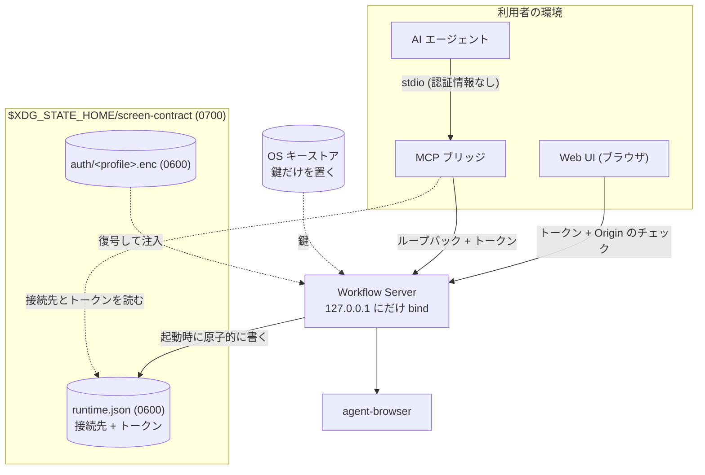

# ローカル実行のセキュリティ

## Overview

この文書は、利用者の開発マシンで動く Workflow Server を、同じマシンのほかのプロセスとブラウザから守る設計を持つ。  
対象は、Web UI、MCP ブリッジ、App Server 型 JSON-RPC のクライアントが Workflow Server へつなぐ接続と、認証状態と secret の保管である。  
全体の構成は [Design Doc](../../DesignDoc.md#components) にある。

Workflow Server は 127.0.0.1 にだけ bind し、ループバックの接続にローカルトークンを要求する。  
ADR-0021: [agent interface の認可](../../../adr/0021-agent-interface-authz.md)

認証状態は、OS のキーストアの鍵で暗号化した Storage State として持つ。  
ADR-0022: [認証状態の保存](../../../adr/0022-auth-state-storage.md)

## Scope

持つものは次のとおり。

- 常駐する Workflow Server の接続先を、ほかのプロセスへ渡す方法
- ローカルトークンの生成、比較、受け渡し
- 接続の相手ごとの認証
- MCP ブリッジが転送してよい範囲
- Origin と Host のチェック
- 認証状態の取り込みと失効の扱い
- 認証状態と secret の暗号化の契約
- DSL が名前で参照する secret の解決

持たないものは次のとおり。

- 秘密情報を置くディレクトリ、置かない場所、置き場のチェック、起動時のチェック。取り決めは [context/operations.md](../../../context/operations.md#secrets) にある。
- 実行してよい origin の限定。取り決めは [context/operations.md](../../../context/operations.md#environments) にある。
- Browser Port が認証コンテキストを受け取る契約と、`auth/expired` を返す条件。[冪等実行と再生制御](../../../packages/core-execution/DesignDoc.md) が持つ。
- DSL の `fill` に `secret: <名前>` を書く記法。[ワークフロー定義](../../../packages/core-workflow/DesignDoc.md) が持つ。
- tool の語彙と、エージェントへの公開の形。[AI エージェント操作](../../../packages/agent/DesignDoc.md) が持つ。
- リモートに公開するときの OAuth と OIDC。MVP の対象外にする。

## Design

### 接続ごとの認証

次の図は、Workflow Server へつなぐ接続ごとの認証と、`runtime.json` と認証状態の保管を示す。

ローカルトークンは、HTTP、App Server 型 JSON-RPC、Stream Proxy が要求する。  
MCP は stdio でつなぐため、エージェントの側ではトークンを要求しない。  
MCP ブリッジがループバックの側でトークンを付ける。  
ADR-0021: [agent interface の認可](../../../adr/0021-agent-interface-authz.md)

トークンの受け渡しは、受け取る側ごとに次のようにする。

- MCP ブリッジ: `runtime.json` を読む。
- App Server 型 JSON-RPC のクライアント: `runtime.json` を読む。
- Web UI（ブラウザ）: Workflow Server が配信する HTML に埋め込む。URL の query に載せない。
- Stream Proxy（WebSocket）: 接続した後の最初のフレームで認証する。URL の query に載せない。

ブラウザは `runtime.json` を読めないため、Web UI だけは別の受け渡しが要る。  
URL の query に載せないのは、URL がブラウザの履歴、`Referer` ヘッダ、サーバーのアクセスログに残るためである。  
WebSocket は任意のヘッダを付けられないため、接続した後の最初のフレームで認証する。

### 常駐サーバーの接続先

MCP ブリッジと App Server 型 JSON-RPC のクライアントは別のプロセスで、Workflow Server の待受のポートを知る必要がある。  
トークンだけでは接続先が決まらない。  
`runtime.json` は、待受のアドレス、ポート、ローカルトークン、プロセス ID を持つ。

- トークンと接続先を 1 つのファイルにまとめ、原子的に置き換える。別々に書くと、片方だけ新しい状態を読むクライアントが出る。
- Workflow Server は起動したときに書き、終了したときに消す。残っていても、プロセス ID で生きているかを確かめられる。
- 常駐するサーバーは 1 つに限る。複数が動くと、どちらへつながったかで見える run が変わる。
  - 二重の起動を止める起動時のチェックは [context/operations.md](../../../context/operations.md#health-and-monitoring) にある。
- ポートは固定せず、OS に割り当てさせて、結果を `runtime.json` へ書く。固定すると、ほかのアプリと衝突する。

### ローカルトークン

- Workflow Server の起動ごとに生成し、接続先と一緒に `runtime.json` へ書き出す。プロセスが終了するときに消す。
- 暗号論的に安全な乱数の生成器で、32 バイト以上を生成する。連番、時刻、プロセス ID から作らない。
- 比較は定数時間で行う。通常の文字列の比較は、先頭からの一致の長さで処理の時間が変わり、1 バイトずつ総当たりできる。
- `runtime.json` は 0600、置き場のディレクトリは 0700 で作る。作るときに権限を確かめ、緩ければ起動を中止する。
- ログ、エラーメッセージ、成果物に出さない。

### MCP ブリッジが転送してよい範囲

MCP ブリッジはトークンを付ける立場にあるため、転送してよい method を agent の tool の語彙に限る。  
すべての method を素通しさせると、stdio を握った任意のプロセスが、トークンなしで Stream Proxy と管理の API へ届く。  
これは、ADR-0021 が採らなかった「認証のないポートを公開する」案と同じ到達性になる。  
ADR-0021: [agent interface の認可](../../../adr/0021-agent-interface-authz.md)

### Origin と Host のチェック

ブラウザからの呼び出しと DNS rebinding を防ぐため、`Origin` ヘッダを確かめる。

- `http://127.0.0.1:<自分の待受のポート>` と、同じポートの `localhost`: 許可する。
- それ以外の値: 403 で拒否する。ポートだけが違うものも拒否する。
- ヘッダがない要求: ブラウザ以外からの要求として、トークンだけで判定する。

任意のポートを許可しない。  
許可すると、同じマシンで動く別のローカルの Web アプリからの cross-origin の要求が通る。

`Host` ヘッダも確かめ、`127.0.0.1:<自分の待受のポート>` 以外を拒否する。  
DNS rebinding の主な防御は Host のチェックで、Origin のチェックだけでは足りない。

### 認証状態の取り込みと失効

- 認証状態の実体は、cookie と localStorage の JSON（Storage State）である。
- 鍵は OS のキーストアに置き、JSON の本体は鍵で暗号化して `auth/<authProfile>.enc` に保存する。キーストアの service と account の名前は [context/operations.md](../../../context/operations.md#secrets) にある。
- 取り込みは、人間がブラウザで手動でログインし、その時点の Storage State を取り込む導線で行う。MFA と SSO がある場合も、人間が通るのは最初の 1 回だけになる。
- 失効したときは、機械が読めるコード `auth/expired` を持つ構造化エラーを返し、取り込み直しを促す。
  - `auth/expired` を返す条件は、[冪等実行と再生制御](../../../packages/core-execution/DesignDoc.md) にある。

ADR-0022: [認証状態の保存](../../../adr/0022-auth-state-storage.md)

### 暗号化の契約

Storage State は、そのまま使える資格情報を含む。  
そのため、機密性に加えて改ざんの検知が要る。  
検知しないと、書き換えられたファイルを復号して注入し、攻撃者の指定した状態でブラウザを動かすことになる。

暗号化は次の契約に従う。

- 暗号方式: 認証付き暗号（AEAD）を使う。AES-256-GCM か XChaCha20-Poly1305 にする。
- 鍵: 暗号論的に安全な乱数で 32 バイトを生成し、OS のキーストアにだけ置く。
- nonce: 暗号化のたびに乱数で生成する。同じ鍵で再利用しない。
- ファイル形式: 形式のバージョン、鍵のバージョン、nonce、認証タグ、暗号文の順に持つ。
- 追加認証データ: 形式のバージョン、鍵のバージョン、`authProfile` を AAD に含め、ファイルの間違えを検知する。
- 認証に失敗したとき: 復号の結果を使わずに中止する（fail closed）。一部が読めても続けない。
- 書き込み: 一時ファイルへ書いてから置き換える。途中で落ちても、書きかけのファイルを残さない。
- 鍵の入れ替え: 鍵のバージョンを上げ、既存のファイルを復号して新しい鍵で暗号化し直す。

形式のバージョンと鍵のバージョンを持たせるのは、方式を変えるときに既存のファイルを読めなくしないためである。

### DSL が参照する secret

DSL の `fill` は、`secret: <名前>` で入力の値を外から参照する。  
DSL はリポジトリにコミットされるため、値そのものを書かせない。

- 名前と値の対応は `secrets.enc` に置き、Storage State と同じ方式で暗号化する。
- 鍵は Storage State と同じ OS のキーストアに置き、account を分ける。
- 名前が解決できないときは、実行の前に失敗させる。空の文字列で続けない。
- 解決した値を書かない場所は [context/operations.md](../../../context/operations.md#secrets) にある。

### macOS での置き場

秘密情報の置き場は、macOS でも XDG Base Directory に従う同じ配置にする。  
プラットフォームごとに置き場を変えると、調べる手順と手当ての手順が分かれるためである。

## Interface

### 置くファイル

- `$XDG_STATE_HOME/screen-contract/runtime.json`: 待受のアドレス、ポート、ローカルトークン、プロセス ID
- `$XDG_STATE_HOME/screen-contract/auth/<authProfile>.enc`: 暗号化した Storage State
- `$XDG_STATE_HOME/screen-contract/secrets.enc`: 暗号化した secret の名前と値の対応

### 返すエラー

- `auth/expired`: 認証状態が失効した。取り込み直しを促す。
- Origin か Host が合わない要求には、403 を返す。

### チェック

テストの観点は [context/testing.md](../../../context/testing.md#required-tests) の、認可と秘密情報の負のテストにある。
