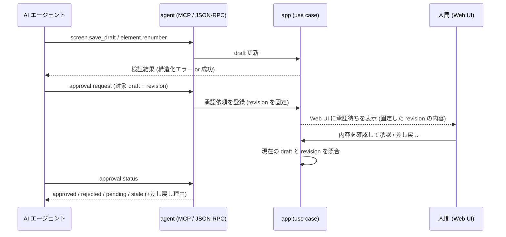
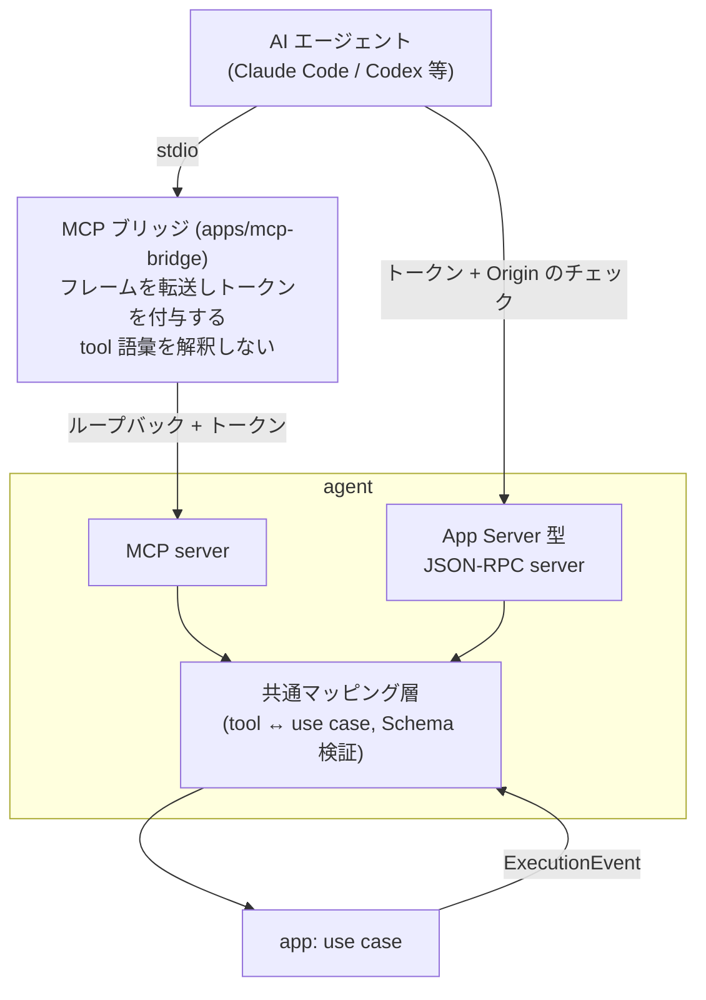

# AI エージェント操作

## Overview

agent モジュールは、AI エージェント（Claude Code、Codex など）が本システムを操作するための interface 層である。  
agent はドメインロジックを持たず、すべての tool で app 層の use case を 1 対 1 で呼ぶ。  
人間用の Web UI と同じ use case を呼び、操作できる範囲の差は、確定に人間の承認を要するかどうかだけに置く。  
層の分け方は [Design Doc](../../design/DesignDoc.md#components) にある。  
この文書の設計が満たす条件は [PRD の Success Metrics](../../PRD.md#success-metrics) にある。

DSL の変更、構成番号、Baseline の更新の確定は、人間の承認を要する。  
エージェントは確定を実行できず、承認を依頼するところまでを行う。  
draft と確定の規則は [draft と確定](../../context/domain/draft-and-confirmation.md) にある。  
ADR-0017: [エージェントの操作範囲を draft までとし確定に人間の承認を要する](../../adr/0017-agent-draft-boundary.md)

agent は、MCP server と App Server 型 JSON-RPC の両方を提供する。  
ADR-0016: [agent interface に MCP と App Server 型 JSON-RPC の両方を採用する](../../adr/0016-dual-agent-protocol.md)

## Scope

持つものは次のとおり。

- tool の語彙（名前空間、入出力、粒度の原則）
- MCP server と App Server 型 JSON-RPC の対応と、機能の差
- 実行イベント（ExecutionEvent）の配信の方法
- 承認依頼（approval）の interface
- エラー応答の形式

持たないものは次のとおり。

- use case の実装。app 層が持ち、tool は呼ぶだけにする。
  - 層の責務は [Design Doc](../../design/DesignDoc.md#components) にある。
- 実行イベントの語彙の定義。[冪等実行と再生制御](../core-execution/DesignDoc.md) が持つ。
- 認証の実装と、秘密情報の置き場。この文書は接続ごとの認証の要件だけを示す。
  - 認証は [ローカル実行のセキュリティ](../../design/features/local-security/DesignDoc.md) が持つ。
  - 秘密情報の置き場は [operations.md](../../context/operations.md#secrets) が持つ。
- リモート公開のときの OAuth と OIDC。MVP では実装しない。
  - ADR-0021: [agent interface の認可をループバック限定とローカルトークンで行う](../../adr/0021-agent-interface-authz.md)
- 人間向けの UI。[Web UI](../../apps/web/DesignDoc.md) が持つ。
- エージェントの側の実装（Claude Code の skill や Codex の設定）

## Design

### 公開原則

- **tool は、app の use case と 1 対 1 にする。**
  - エージェントの 1 つの意図が、1 回の呼び出しで完結する粒度にする。
  - 細かい CRUD の組み立てを、エージェントに求めない。
- **すべての tool は、draft の空間で作用する。**
  - 確定済みのデータ（Baseline、確定済みの DSL）を変更する tool はない。
  - 確定に関わる tool は承認依頼の `approval.request` だけで、これは人間への通知であり、確定そのものではない。
- 入出力は、すべて JSON Schema で定義し、両方のプロトコルで共有する。
- 読み取りの系（`*.list`、`*.get`）と、draft を変更する系を、名前の動詞で区別できるようにする。

### 認可

常駐サーバーは、127.0.0.1 にだけ bind する。  
接続ごとに、認証の要件が異なる。  
ADR-0021: [agent interface の認可をループバック限定とローカルトークンで行う](../../adr/0021-agent-interface-authz.md)

| 接続                   | 認証                                 | 備考                                               |
| ---------------------- | ------------------------------------ | -------------------------------------------------- |
| MCP（stdio）           | エージェントの側は認証情報を持たない | MCP ブリッジが、ループバックの側でトークンを付ける |
| App Server 型 JSON-RPC | ローカルトークンと Origin のチェック | クライアントがトークンのファイルを読む             |
| Stream Proxy           | ローカルトークンと Origin のチェック | Web UI のライブ映像と入力転送が通る                |

Stream Proxy の構成は、[Web UI](../../apps/web/DesignDoc.md#stream-proxy-の接続構成) にある。  
ADR-0008: [ライブ映像は Workflow Server 経由の Proxy で配信する](../../adr/0008-stream-proxy.md)

トークンの生成と受け渡し、Origin と Host のチェックは、[ローカル実行のセキュリティ](../../design/features/local-security/DesignDoc.md#接続ごとの認証) にある。

#### MCP ブリッジ

MCP ブリッジ（`apps/mcp-bridge`）は、エージェントが stdio で起動する、薄い転送のプロセスである。  
ブリッジは tool の語彙を解釈せず、JSON-RPC のフレームをループバックへ転送して、トークンを付ける。  
ブリッジ自身は依存のグラフの終端にあり、app と core を参照しない。  
ブリッジを別のプロセスにするのは、MCP の利用者にトークンの取り回しを負わせないためである。  
ADR-0021: [agent interface の認可をループバック限定とローカルトークンで行う](../../adr/0021-agent-interface-authz.md)

ブリッジが転送してよい method は、agent の tool の語彙に限る。  
範囲と理由は、[ローカル実行のセキュリティ](../../design/features/local-security/DesignDoc.md#mcp-ブリッジが転送してよい範囲) にある。

### run 系の tool は draft の空間に閉じない

`screen.save_draft` などの tool は、管理対象のデータの draft へ書くだけである。  
それに対し、`run.start`、`run.resume`、`run.rerun_step` は、対象の Web アプリケーションを実際に操作する。  
クリックと入力が外部に副作用を起こすため、draft の安全の境界では守れない。  
ADR-0017: [エージェントの操作範囲を draft までとし確定に人間の承認を要する](../../adr/0017-agent-draft-boundary.md)

| 制約         | 内容                                                                   |
| ------------ | ---------------------------------------------------------------------- |
| 対象の限定   | 実行してよい origin を設定で列挙し、**列挙の外への `open` を拒否する** |
| 記録         | どの run がどの origin へ何を行ったかを、実行の履歴に残す              |
| 破壊的な操作 | 対象のアプリの側の取り消せない操作を、本システムは判別できない         |

実行してよい origin の設定の置き場は、[operations.md の Environments](../../context/operations.md#environments) にある。

**run 系の tool を、人間の承認の対象にしない。**  
代わりに、対象の限定と記録で守る。  
ADR-0017: [エージェントの操作範囲を draft までとし確定に人間の承認を要する](../../adr/0017-agent-draft-boundary.md)

対象のアプリを選ぶのは、利用者の責任である。  
本番環境を対象に指定できる点は、設定と文書で明示する。

### 提案依頼キュー

人間は、Web UI から候補生成を依頼する。  
エージェントは、依頼を `suggestion.list` で取り出し、`suggestion.respond` で応答を返す。  
キューは pull 型にし、サーバーからエージェントへ push しない。  
ADR-0020: [人間起点の提案依頼を pull 型キューで実現する](../../adr/0020-suggestion-pull-queue.md)

| 状態       | 意味                                         |
| ---------- | -------------------------------------------- |
| `pending`  | 依頼が積まれ、まだ誰も応答していない         |
| `answered` | いずれかのエージェントが応答した             |
| `expired`  | 期限を過ぎた。人間が手動で名付ける導線へ戻す |

**依頼を、特定のエージェントへ排他的に割り当てない。**  
複数のエージェントが同じ依頼を取り出してよい。応答は複数の draft として並び、人が選ぶ。  
ADR-0020: [人間起点の提案依頼を pull 型キューで実現する](../../adr/0020-suggestion-pull-queue.md)

`expired` を用意するのは、AI がいなくても完結するという要件を守るためである。  
応答がないまま、利用者を待ち続けさせない。

#### 待ち時間を縮める購読

未処理の依頼のリストを 1 つのリソースとして公開し、MCP のリソースの購読で更新を通知する。  
ADR-0020: [人間起点の提案依頼を pull 型キューで実現する](../../adr/0020-suggestion-pull-queue.md)

| 段階                     | やりとり                                                                    |
| ------------------------ | --------------------------------------------------------------------------- |
| サーバーの宣言           | `capabilities.resources.subscribe: true`                                    |
| エージェントの購読       | `subscriptions/listen` に依頼リストの URI を `resourceSubscriptions` で渡す |
| 依頼が積まれたときの通知 | サーバーが `notifications/resources/updated` を送る                         |
| 取得                     | `resources/read` または `suggestion.list`                                   |

**通知は、見に来る合図であり、割り当てではない。**  
エージェントは、通知を取りこぼしても、`suggestion.list` のポーリングで追いつける。  
そのため、購読は最適化であり、前提にしない。

### プロトコルの対応

MCP は、stateless になった後の現行の仕様に従う。  
旧仕様の initialize のハンドシェイク、プロトコルのセッション、任意の server 通知を前提にしない。  
出典: [MCP の仕様（現行版）](https://modelcontextprotocol.io/specification/2026-07-28)  
出典: [MCP の変更点（stateless 化、通知の再設計、Tasks 拡張）](https://modelcontextprotocol.io/specification/2026-07-28/changelog)

App Server 型 JSON-RPC は、Codex App Server を参考の実装にする。  
出典: [Codex App Server](https://github.com/openai/codex/tree/main/codex-rs/app-server)  
出典: [App Server の設計の背景](https://openai.com/index/unlocking-the-codex-harness/)

2 つのプロトコルの違いは次のとおり。

| 観点            | MCP server                                                                                       | App Server 型 JSON-RPC                               |
| --------------- | ------------------------------------------------------------------------------------------------ | ---------------------------------------------------- |
| 接続            | エージェントの設定に 1 行を足す（標準）。stateless で、セッションを持たない                      | 専用のクライアントの実装が要る。接続の実装は容易     |
| tool の呼び出し | MCP の tools（tool の語彙と同じ名前）。run id などは、サーバーが発行したハンドルとして引数で渡す | JSON-RPC の method（同じ名前、同じ Schema）          |
| 実行イベント    | Tasks 拡張と、`run.events` のポーリング                                                          | 双方向のストリームで、サーバーが push する（低遅延） |
| 提案依頼の取得  | 依頼のリストをリソースとして購読し、通知を合図に取りに来る                                       | ロングポーリングで待てる                             |
| 想定する用途    | 汎用のエージェントからの操作                                                                     | 常駐と低遅延が要る統合（エディタの拡張など）         |

ADR-0016: [agent interface に MCP と App Server 型 JSON-RPC の両方を採用する](../../adr/0016-dual-agent-protocol.md)

- 両方のプロトコルは、同じ tool の語彙と、同じ JSON Schema を共有する。
  - agent モジュールの中の共通のマッピング層が、app の use case へ変換する。
  - プロトコルに固有の処理（通知とタスクの形式）だけを、各サーバーの実装に置く。
- イベントの語彙と順序は、[冪等実行と再生制御](../core-execution/DesignDoc.md) の ExecutionEvent と同じにする。
  - プロトコルによって、イベントの内容は変わらない。
- `tools/list` は、決定的な順序で返す。
  - 仕様の SHOULD に従う。クライアントの側のキャッシュと、LLM のプロンプトのキャッシュのためである。
  - 出典: [MCP の仕様（現行版）](https://modelcontextprotocol.io/specification/2026-07-28)

### MCP でのイベント配信

現行の仕様では、サーバーからクライアントへの任意の通知が廃止されている。  
push は、`subscriptions/listen` のリストの変更と、リソースの購読に限られる。  
request-scoped の `notifications/progress` は、元の呼び出しの応答のストリームの上でだけ流せる。  
出典: [MCP の変更点（stateless 化、通知の再設計、Tasks 拡張）](https://modelcontextprotocol.io/specification/2026-07-28/changelog)

MCP では、次の 3 つを組み合わせて実行イベントを届ける。

1. Tasks 拡張（`io.modelcontextprotocol/tasks`）: `run.start` は、長時間の実行としてタスクのハンドルを返す。
   - エージェントは、`tasks/get` のポーリングで、進行の状態（現在のステップ、RunStatus）を追う。
   - 出典: [MCP Extensions](https://modelcontextprotocol.io/docs/extensions/overview)
2. `run.events` によるイベントの列の取得: エージェントは、カーソル（最後に読んだイベントの位置）を渡して差分を取得する。
   - イベントの列は append-only なので、ポーリングの間隔によらず取りこぼしがない。
3. `notifications/progress`: `run.start` の応答のストリームが開いている間は、ステップの進行を progress として流す。
   - 接続が切れたら、Tasks 拡張と `run.events` の取得に切り替える。

低遅延の push が要る統合は、App Server 型 JSON-RPC を使う。  
ADR-0016: [agent interface に MCP と App Server 型 JSON-RPC の両方を採用する](../../adr/0016-dual-agent-protocol.md)

### 承認依頼の流れ

次の図は、エージェントが draft を保存して承認を依頼し、人間の判断の結果を受け取るまでの流れを示す。

- 差し戻しには、人間のコメントを構造化して含める。
  - エージェントは、理由を読んで修正し、再び依頼できる。
- 承認を待つ間も、エージェントはほかの draft の作業を続けられる。
  - 承認は、エージェントの処理を止めない。

**`approval.request` は、対象の draft の revision を固定する。**  
固定しないと、依頼の後にエージェントが編集した内容まで、人間が見ていない差分のまま確定する。  
承認がエージェントの処理を止めないためである。  
承認するときに、現在の draft の revision と比べる。  
一致しなければ確定せず、`stale` を返して再確認を求める。  
ADR-0017: [エージェントの操作範囲を draft までとし確定に人間の承認を要する](../../adr/0017-agent-draft-boundary.md)

revision は、draft の内容から決まる値にする。  
編集していなければ同じ値になり、1 文字でも変われば別の値になる。

### コンポーネントの構成

次の図は、MCP ブリッジ、2 つのサーバー、共通のマッピング層、app の use case の関係を、C4 の L3 で示す。

ブリッジは `apps/` に置き、依存のグラフの終端にする。  
依存の規則は [codebase.md の Dependency Rules](../../context/codebase.md#dependency-rules) にある。

## Interface

### tool の語彙

MVP で公開する tool は次のとおり。

| namespace  | tool                                                     | 内容                                                                                               |
| ---------- | -------------------------------------------------------- | -------------------------------------------------------------------------------------------------- |
| screen     | `screen.list` / `screen.get`                             | Screen 文書の一覧と取得。draft と確定済みの別を含む                                                |
| screen     | `screen.save_draft`                                      | Screen 文書を draft に保存する。保存時に Schema の検証と正規化のチェックを行い、構造化エラーを返す |
| workflow   | `workflow.list` / `workflow.get` / `workflow.save_draft` | Workflow 文書の一覧、取得、draft への保存                                                          |
| run        | `run.start`                                              | 対象（screen と state、または workflow）を指定して、実行を開始する                                 |
| run        | `run.pause` / `run.resume` / `run.rerun_step`            | 再生の制御                                                                                         |
| run        | `run.get` / `run.events`                                 | 実行の状態の取得と、イベントの列の取得                                                             |
| element    | `element.candidates`                                     | 座標または Snapshot への問い合わせから、要素候補の列を得る                                         |
| element    | `element.renumber`                                       | 再採番を計算し、NumberingPlan を draft に反映する                                                  |
| artifact   | `artifact.preview`                                       | draft の内容で、成果物（注釈画像、テーブル）を試しに生成する。Baseline は更新しない                |
| diff       | `diff.compare`                                           | 現在の draft と実行の結果を Baseline と比較し、分類した差分を返す                                  |
| approval   | `approval.request` / `approval.status`                   | 指定した draft（DSL 変更、NumberingPlan、Baseline の更新）の承認を人間へ依頼し、状態を確かめる     |
| suggestion | `suggestion.list` / `suggestion.respond`                 | 人間が出した候補生成の依頼を取り出し、推論の結果を返す                                             |

再生の制御の意味は、[冪等実行と再生制御](../core-execution/DesignDoc.md) が定める。  
イベントの列の配信は、[MCP でのイベント配信](#mcp-でのイベント配信) にある。

### エラー応答の形式

すべての tool は、失敗したときに `{ code, message, path?, hint? }` の構造化エラーを返す。  
エージェントがエラーを読んで自己修正できるようにするためである。

- `code`: 機械可読のコード。例は `schema/unknown-field`、`ref/unresolved`、`run/not-paused`
- `message`: 人間が読む文
- `path`: DSL の中の位置
- `hint`: 修正の方向

形式は、[ワークフロー定義](../core-workflow/DesignDoc.md) の検証エラーの形式をそのまま使い、interface 層で変換しない。

### チェック

テストの共通の規約は [context/testing.md](../../context/testing.md) にある。  
この機能に固有の観点は次のとおり。

- 両方のプロトコルの等価性: 同じ tool の呼び出しが、同じ use case の呼び出しに変換されること。共通のマッピング層の unit test で確かめる
- Schema の検証: 不正な入力の拒否と、構造化エラーの形式
- draft の境界: どの tool の組み合わせでも、確定済みのデータ（Baseline、確定済みの DSL）が変更されないこと
- イベントの配信: ExecutionEvent の順序の保存、カーソルを指定した `run.events` で取りこぼしなく追いつけること、Tasks 拡張のポーリングと progress の整合
- 承認の流れ: request から status までの状態の遷移と、差し戻しの理由が伝わること
