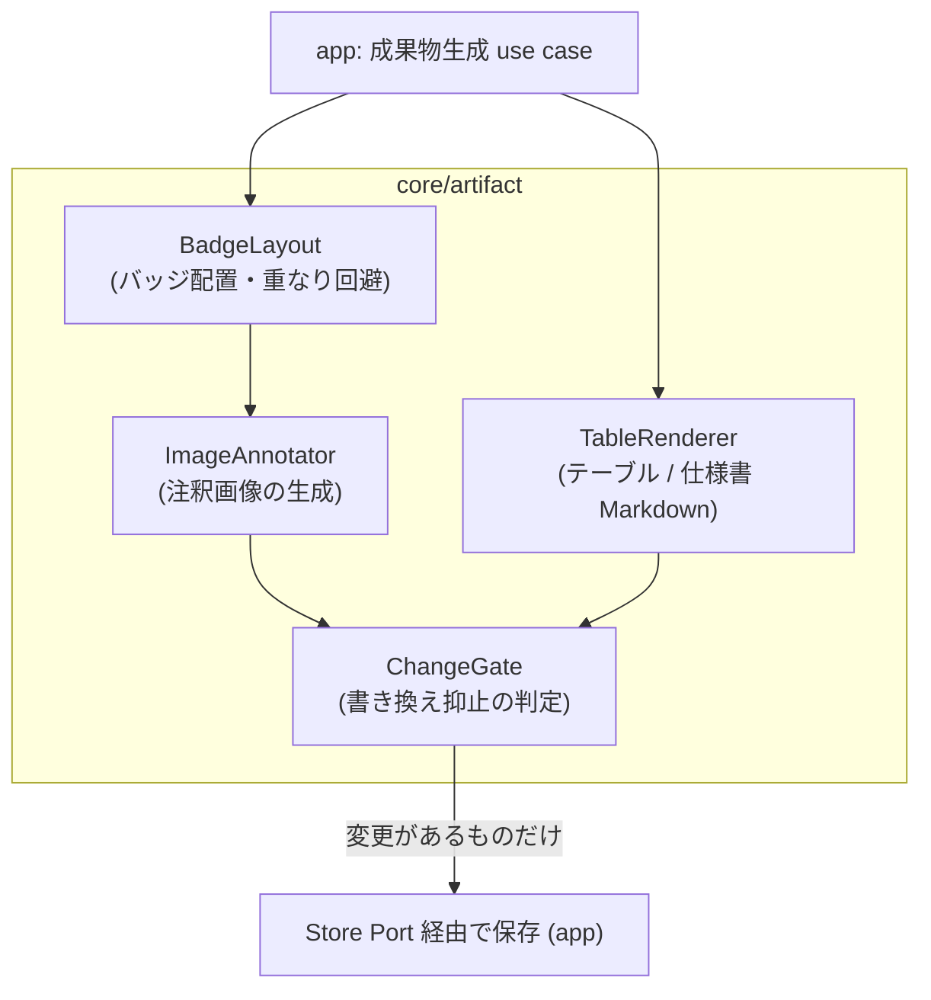
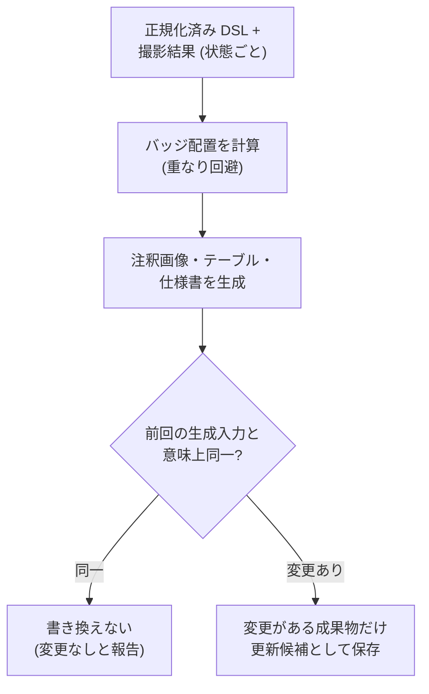

# 仕様成果物の生成

## Overview

core/artifact は、DSL と撮影結果から、画面仕様書の成果物を決定的に生成する。  
成果物の種類と生成の単位、注釈画像の番号バッジの描き方、Markdown のテーブルの列と行、Playwright の POM の生成の規則を持つ。  
意味上の変更がないときに、既にある成果物を書き換えない判定も持つ。  
満たす成功条件は [PRD の Success Metrics](../../PRD.md#success-metrics) にあり、全体の構成は [Design Doc](../../design/DesignDoc.md#components) にある。

生成は、DSL と撮影結果を入力とする決定的な写像である。  
成果物の側にしかない情報を作らない。  
成果物は生成物で、手で編集しない。  
出典: [context/codebase.md の State Ownership](../../context/codebase.md#state-ownership)

## Scope

持つものは次のとおり。

- 成果物の種類（注釈画像、構成要素のテーブル、Playwright の POM のコード）と、生成の単位
- 番号バッジの配置と、重なりを避ける規則
- テーブルの列の構成と行の順（構成番号の順）、番号のない要素と削除の扱い
- 「意味上の変更がない」の判定の規則と、書き換えの抑止
- 成果物のファイルの配置の規則。保存そのものは、app が Store Port を通して行う。

持たないものは次のとおり。

- 撮影（スクリーンショットと bounding box の取得）。adapter/browser が行い、core/artifact は入力の値として受け取る。
- 構成番号の採番。[要素の同一性と採番の Design Doc](../core-element/DesignDoc.md) が持つ。
  - core/artifact は DSL に書かれた番号を使うだけで、番号を計算しない。
- Baseline との差分の検知。[変更差分の検知の Design Doc](../core-diff/DesignDoc.md) が持つ。
- 成果物のプレビューの UI。[Web エディタの Design Doc](../../apps/web/DesignDoc.md) が持つ。
- PDF や HTML など、仕様書のほかの形式での出力。MVP では実装しない。
  - 出典: [PRD の Lower-Priority Goals](../../PRD.md#lower-priority-goals)
- 生成した POM を使うテストのコードの生成。提供するのは POM のクラスまでにする。

## Design

### 成果物の種類と生成の単位

| 成果物                         | 単位                      | 内容                                                                                           |
| ------------------------------ | ------------------------- | ---------------------------------------------------------------------------------------------- |
| 注釈画像（PNG）                | 画面の状態ごとに 1 枚     | その状態のスクリーンショット（clip の指定があれば切り抜き）に、badges の番号バッジを重ねたもの |
| 構成要素のテーブル（Markdown） | **画面の状態ごとに 1 つ** | その状態の要素を構成番号の順に並べた表。番号は状態の中で 1..N                                  |
| 画面仕様書（Markdown）         | 画面ごとに 1 つ           | 画面のタイトルと、状態ごとの「注釈画像とテーブル」の組を、状態の木の DFS の順に並べた文書      |

ADR-0005: [構成番号の採番](../../adr/0005-renumbering.md)

生成の入力は、Screen IR と撮影結果の 2 つで、どちらも core/artifact にとっては引数である。

- Screen IR: core/workflow が正規化した、画面全体のモデル。要素定義、badges、状態の木を含む。
- 撮影結果: 状態ごとのスクリーンショットと、要素の bounding box。

core/artifact は、IR と Locator の型の参照だけで core/workflow と core/element に依存する。  
規約は [context/codebase.md の Dependency Rules](../../context/codebase.md#dependency-rules) にある。

### 注釈画像の描画規則

撮影と注釈は 2 段に分ける。  
撮影（生のスクリーンショットと、各要素の bounding box の取得）は、実行時に adapter/browser が行う。  
注釈（バッジの配置の計算と合成）は、core/artifact の純粋な計算である。  
生のスクリーンショットと bounding box は保存し、バッジは何度でも合成し直せる。  
再採番や badges の並べ替えだけなら、撮影し直さなくてよい。

**差分の検知（Visual Diff）の対象は、生のスクリーンショットにする。**  
バッジを合成した注釈済みの画像は、差分の検知の対象にしない。  
ADR-0007: [Visual Diff](../../adr/0007-visual-diff.md)

- バッジの位置の基準は、撮影時に取得した対象の要素の bounding box にする。
  - 座標は viewport のピクセル座標で、`clip` を指定したときは切り抜いた後の画像の座標へ変換する。
  - selector から位置を計算しない。Locator の解決は、バッジを描く前の撮影時に済んでいる。
- バッジは、bounding box の左上の角の外側に、固定のオフセット（設定値）で描く。
  - 画像の端にかかるときは、box の内側へ寄せる。
- バッジ同士が重なるときは、読み順で後の要素のバッジを右へずらす。ずらす量は固定値にする。
  - 決定的に解決できない重なりは、生成の警告として報告する。
- バッジの形、配色、フォントは固定のスタイルの設定（設定値）にし、要素ごとに変えない。
- バッジを描くのは、state の `badges` に載る要素だけにする。
  - `optional` と `child_doc` の要素と、その状態に現れない要素は描かない。現れるかどうかは、継承の規則を展開した結果に従う。
- `all` を指定した要素は、Locator に一致するすべての要素へ、同じ番号のバッジを描く。
  - 件数の上限は設定値にし、超えたら生成の警告にする。

### 構成要素のテーブルの構成

テーブルは状態ごとに生成し、行は次の 3 種類からなる。

| 行の種類                             | 番号の列              | 内容                                                                                                    |
| ------------------------------------ | --------------------- | ------------------------------------------------------------------------------------------------------- |
| バッジの要素                         | 1..N（badges の位置） | 名称と種別を出す。行の順は番号の順                                                                      |
| 条件付きで表示する要素（`optional`） | `-`                   | 名称、種別、`note`（表示の条件や、特定できない理由）を出す。未実装（`unimplemented`）はその旨を注記する |
| 子文書の要素（`child_doc`）          | なし                  | 名称を、対象の Screen の仕様書へのリンクとして出す                                                      |

- 列は「番号、名称、種別、備考」にする。
  - 種別は、要素定義の `type`（固定の enum と custom）にする。
- Locator はテーブルに載せない。
  - Locator は実装の詳細で、仕様書の読者には要らない。要るときは DSL を見る。

### Playwright の POM のコードの生成規則

POM は、Workflow IR からの決定的な codegen で作る。  
生成したコードは編集を禁じ、生成のヘッダでそれを明示する。  
拡張は、クラスの継承など、生成物の外で行う。  
ADR-0006: [Playwright の POM の出力](../../adr/0006-playwright-pom-output.md)

Playwright への依存は、生成物を使う側にだけ生じる。  
本システムの実行（agent-browser）、仕様書の生成、差分の検知は Playwright に依存しない。  
POM の生成もテキストの生成で、ランタイムを要しない。  
POM は、プロダクトの設定で明示的に有効にしたときだけ生成する（`outputs: [spec]` か `[spec, pom]`）。  
Playwright を使わない利用者は、仕様書の生成だけで済む。  
codegen の Locator と action の対応表は、出力の target ごとに持つ。

- 入力は Screen IR にする。
  - Screen IR から、画面ごとの Page Object のクラスを作る。
  - 要素定義から型付きの locator のプロパティを、状態遷移の steps から遷移のメソッドを、Expectation から対応する assertion の helper を作る。
- Expectation の意味の基準は、core/execution の評価規則にする。
  - assertion への対応表は、[冪等実行と再生制御の Design Doc](../core-execution/DesignDoc.md#ステップ実行のルール) の評価規則と同じ意味になるよう定める。
  - 対応できない Expectation（Playwright で表せない条件）は生成時の警告にし、警告を出さずに意味を変えることはしない。
- Workflow の文書からは、到達の手順の fixture と helper を作る。
- Locator の対応は次のとおり。
  - `role+name` → `getByRole`、`label` → `getByLabel`、`testid` → `getByTestId`、`text` → `getByText`、`css` と `index` → `locator().nth()`
  - agent-browser と Playwright で意味が一致しない Locator は、生成時の警告にする。
- **`index` は 1 始まり、Playwright の `nth()` は 0 始まりである。** 変換するときは必ず 1 を引く（`nth(index - 1)`）。
  - 引き忘れると、生成した POM が隣の要素を操作する。実行しても例外にならず、間違った要素への操作が何も知らせずに成功しうるため、生成時に気付けない。
  - `index` はすべての Locator の戦略で使えるため、変換は 1 か所にまとめる。戦略ごとに書くと、片方だけ直し忘れる。
  - `index` が 1 より小さいか、一致した件数を超えるときは、生成のエラーにする。範囲の外の値を `nth()` へ渡すと、実行するまで問題が現れない。
- 識別子は、要素の ID と状態の id から決定的に導く。同じ IR からは常に同じコードになる。
  - 要素の ID から `el-` の接頭辞を除いた camelCase をプロパティ名にする（`el-username` → `username`）。
  - 状態遷移のメソッドは `to<遷移先の状態>` にする（`toModalOpen`）。
  - 状態の期待状態を確かめるメソッドは `expect<状態>` にする（`expectModalError`）。
  - entry は static の `goto` にする。
- 導いた識別子の重複と予約語との衝突は生成のエラーにし、要素の ID の変更を促す。

次のコードは、Workflow DSL の Screen の例から生成するコードの構造を示す。

```ts
// Generated by screen-contract from screens/login.yaml — DO NOT EDIT
import { type Locator, type Page, expect } from "@playwright/test";

export class LoginScreen {
  readonly username: Locator; // el-username
  readonly openModal: Locator; // el-open-modal
  readonly modal: Locator; // el-modal
  readonly modalSubmit: Locator; // el-modal-submit
  readonly toast: Locator; // el-toast

  constructor(readonly page: Page) {
    this.username = page.getByRole("textbox", { name: "ユーザー名" });
    this.openModal = page.getByRole("button", { name: "設定を開く" });
    this.modal = page.getByRole("dialog");
    this.modalSubmit = page.getByRole("button", { name: "送信" });
    this.toast = page.getByRole("alert");
  }

  /** entry: workflows/goto-login */
  static async goto(page: Page): Promise<LoginScreen> {
    await page.goto("/login");
    await expect(page).toHaveURL(/\/login/);
    return new LoginScreen(page);
  }

  /** default → modal-open */
  async toModalOpen(): Promise<void> {
    await this.openModal.click();
    await this.expectModalOpen();
  }

  /** modal-open → modal-error (fragments: submit-empty) */
  async toModalError(): Promise<void> {
    await this.modalSubmit.click();
    await this.expectModalError();
  }

  /** modal-error の期待状態 */
  async expectModalError(): Promise<void> {
    await expect(this.toast).toBeVisible();
  }
}
```

- 状態遷移のメソッドは、遷移の steps の実行と、遷移先の Expectation の検証からなる。
  - `expect<状態>` は単独でも呼べる。冪等実行の「期待状態の検証」に対応する。
- `optional` と `child_doc` の要素には、locator のプロパティを生成しない。
  - `optional` は状態によって現れたり消えたりして安定しない。`child_doc` は子の画面のクラスの側で生成される。
- `all` を指定した要素は、複数件の locator（`nth` なし）として生成する。

### 書き換えの抑止と「意味上の変更がない」の判定

成果物を生成し直すときは、次の規則で既存の成果物と比べる。  
変更がなければファイルを書き換えず、タイムスタンプも更新しない。

| 成果物                                  | 比べ方                                                                                                                                                                                             |
| --------------------------------------- | -------------------------------------------------------------------------------------------------------------------------------------------------------------------------------------------------- |
| テーブル、仕様書（Markdown）、POM（TS） | 生成した内容のテキストの比較（完全一致）                                                                                                                                                           |
| 注釈画像（PNG）                         | 画像のバイトではなく、**生成の入力を比べる**。スクリーンショット（clip の適用後）のハッシュと、badges の要素の列と各要素の（番号、bounding box、バッジの位置）の組が前回と同じなら、生成し直さない |

- 画像をバイトで比べないのは、描画エンジンの環境の差でバイトが揺れうるためである。
  - 入力が同じなら、出力は意味の上で同じとみなす。
  - ピクセルの同一性は目標にしない。出典: [PRD の Non-Goals](../../PRD.md#non-goals)
- 「見た目は同じだが入力が変わった」場合（bounding box が 1px 動いたなど）は、書き換えが起きる。
  - 閾値で吸収するのは差分の検知の関心で、生成の側では行わない。[変更差分の検知の Design Doc](../core-diff/DesignDoc.md#画像差分の-2-段階判定) にある。

### 成果物のファイルの配置

出力先は、Screen の文書ごとに `doc` と `image` のパスで指定できる。  
既にある仕様書のディレクトリの構成へ出力するためである。  
指定しないときの既定は次のとおり。

```text
artifacts/
└── screens/<screen-id>/
    ├── spec.md              # 画面仕様書 (状態ごとの画像 + テーブル)
    ├── <state-id>.png       # 状態ごとの注釈画像
    ├── <screen-id>.page.ts  # Playwright POM (編集禁止の生成物)
    └── meta.json            # 生成入力の記録 (書き換え抑止の比較用ハッシュ等)
```

- 配置の規則と既定値は core/artifact が決め、書き込みは app が Store Port を通して行う。
- `meta.json` は、書き換えの抑止と差分の検知のための機械が読む情報で、人が読む文書ではない。
- 成果物も、認証プロファイルごとに分ける。既定の配置は、`screens/<screen-id>/<authProfile>/` を挟む。
  - Baseline は `(screen, state, authProfile)` で識別される。混ぜると、権限の差で見える範囲が違う画像とテーブルが、同じファイルを上書きし合う。
  - ADR-0022: [認証状態の保存](../../adr/0022-auth-state-storage.md)

#### 出力先をプロジェクトのルートの下に限る

**出力先は、プロジェクトのルートの下に限る。**  
出力先は Screen の文書で指定でき、Screen の文書はエージェントが `screen.save_draft` で編集できる。  
制約がないと、`../../../.git/hooks/pre-commit` や `~/.zshrc` を指定して、任意のファイルを書き換えられる。

| 拒むもの                                       | 理由                                       |
| ---------------------------------------------- | ------------------------------------------ |
| 絶対パス                                       | ルートの外へ直接届く                       |
| `..` を含むパス                                | 相対でさかのぼって、ルートの外へ出る       |
| `~` で始まるパス                               | ホームディレクトリへ展開される             |
| 解決した後にルートの外を指すシンボリックリンク | パスの文字列のチェックだけでは通ってしまう |

チェックは、Schema での文字列のチェックと、パスを解決した後の範囲のチェックの 2 段で行う。  
文字列のチェックだけでは、シンボリックリンクを通してしまう。

### コンポーネントの構成

次の図は、core/artifact の内部の構成要素と、app と Store Port とのつながりの L3 を示す。



### 生成と書き換えの抑止の流れ

次の図は、撮影結果から成果物を生成し、意味上の変更があるものだけを更新の候補にする流れを示す。



## Interface

### 入力と出力

- 入力: Screen IR と、状態ごとの撮影結果。どちらも引数として受け取る。
- 出力: 注釈画像、構成要素のテーブル、画面仕様書、POM のコード、`meta.json`。置き場は「成果物のファイルの配置」の節にある。
- 変更のない成果物は出力せず、「変更なし」として報告する。

### 生成の警告とエラー

生成の警告は、生成を止めずに報告する。

- 決定的に解決できないバッジの重なり
- `all` の件数の上限を超えたこと
- assertion に対応できない Expectation
- agent-browser と Playwright で意味が一致しない Locator

生成のエラーは、生成を止める。

- `index` が 1 より小さいか、一致した件数を超える
- POM の識別子の重複と、予約語との衝突
- プロジェクトのルートの外を指す出力先

### チェック

テストの共通の規約は [context/testing.md](../../context/testing.md) にある。  
core/artifact は、純粋なロジック（描画の計算とテキストの生成）を unit テストの主な対象にする。  
この機能に固有の観点は次のとおり。

- 決定性: 同じ DSL と同じ撮影結果から、バッジの配置とテーブルの内容が常に同じになること。
- バッジの配置: 端、重なり、ずらしの境界のケース。解決できない重なりの警告。
- テーブル: 番号の順。`optional` の行（`-` と note）と `child_doc` のリンクの行の出力。状態ごとの独立性（ほかの状態の変更が及ばないこと）。
- 書き換えの抑止: 入力が同じなら書き換えないこと。1 か所を変えたら、該当する成果物だけが更新の候補になること。
- POM の `index` の変換: `index: 1` が `nth(0)` になること。範囲の外（0 以下と、一致した件数の超過）が生成のエラーになること。
  - **この 2 件は実行時に例外にならないため、生成の側で固定する。**
- 出力先の範囲: 絶対パス、`..`、`~` で始まるパス、解決した後にルートの外を指すシンボリックリンクが拒まれること。
- 継承の展開との整合: 状態に現れない要素が、その状態の画像に描かれないこと。
- POM の codegen: 同じ IR からの出力の一致（決定性）、Locator の対応表の網羅、対応できない Locator の生成時の警告、生成のヘッダの付与。
