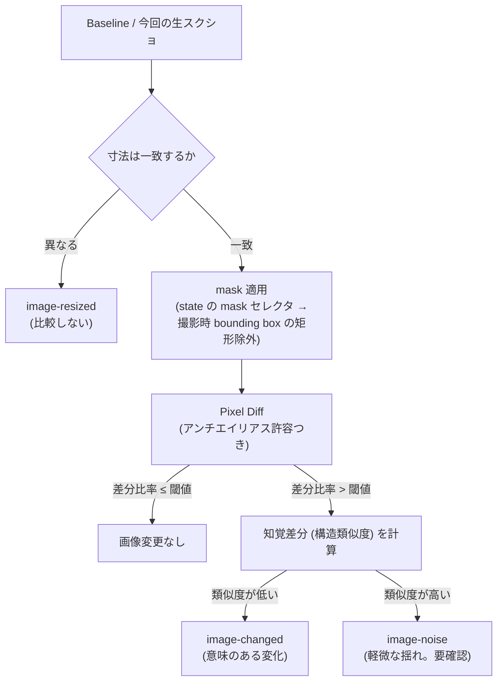
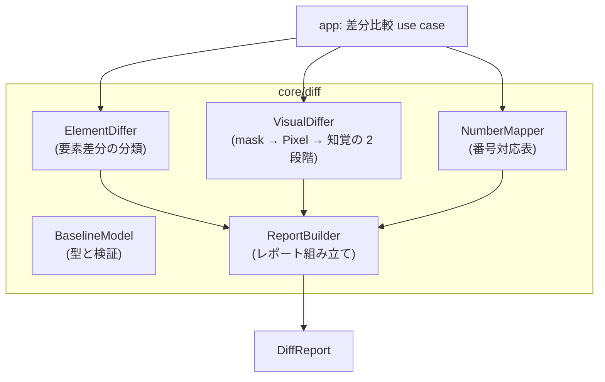

# 変更差分の検知

## Overview

core/diff は、前回に承認した結果（Baseline）と今回の実行の結果を比べ、変更を分類して示す。  
Baseline として何を保存するか、要素差分をどう分類するか、生のスクリーンショットの画像差分をどう判定するか、分類した差分と番号対応表をどうまとめて返すかを持つ。  
満たす成功条件は [PRD の Success Metrics](../../PRD.md#success-metrics) にあり、全体の構成は [Design Doc](../../design/DesignDoc.md#components) にある。  
ADR-0007: [Visual Diff](../../adr/0007-visual-diff.md)

core/diff は純粋なロジックで、Baseline と実行の結果を入力の値として受け取る。  
保存と読み出しは、app が Store Port を通して行う。  
core/diff の責務は、差分を分類して示すところまでにする。  
承認（Baseline の更新）は、人間の承認に委ねる。  
規則は [draft と確定](../../context/domain/draft-and-confirmation.md) にある。

## Scope

持つものは次のとおり。

- Baseline の構造（保存する内容と単位）と、更新の契機
- 要素差分の分類の語彙と、判定の規則
- 画像差分の 2 段階の判定（Pixel Diff と知覚差分）、閾値、mask の適用
- 番号対応表（badges の旧から新への対応）の生成
- 差分レポートの構造（状態ごとの分類した差分の一覧）

持たないものは次のとおり。

- Baseline と実行の結果の保存。app が Store Port を通して行い、core/diff は入力の値として受け取る。
- 差分の承認の UI と表示。[Web エディタの Design Doc](../../apps/web/DesignDoc.md) が持つ。
- 承認による Baseline の更新の編成。app 層の use case が持つ。
  - 承認の規則は [draft と確定](../../context/domain/draft-and-confirmation.md) にある。
- 成果物の書き換えの抑止。[仕様成果物の生成の Design Doc](../core-artifact/DesignDoc.md#書き換えの抑止と意味上の変更がないの判定) が持つ。
  - 書き換えの抑止は、差分の検知とは別の、生成の入力が同じかどうかの判定である。
- CI での定期的な実行と、pull request との連携。MVP では実装せず、core/diff は比較と分類だけを提供する。
  - 出典: [PRD の Lower-Priority Goals](../../PRD.md#lower-priority-goals)

## Design

### Baseline の構造

Baseline は、人間が承認した時点の、実行の結果の組である。

**識別子は `(screen, state, authProfile, generation)` にする。**  
認証プロファイルを識別子に含めないと、ログインした利用者の権限の差に由来する差分が検知の結果を占め、検知したい変更が埋もれる。  
匿名の実行も、1 つのプロファイルとして区別する。  
ADR-0022: [認証状態の保存](../../adr/0022-auth-state-storage.md)

`generation` は、認証状態を取り込んだ世代である。  
プロファイルの名前は変えられ、同じ名前へ別のアカウントの状態を入れられるため、名前だけでは分けきれない。  
**古い generation の Baseline は上書きせずに残す。**  
捨てると、取り込み直した直後に「Baseline 未作成」へ戻り、差分の検知が一度使えなくなる。

識別子ごとに、次の内容を持つ。

| 内容                                                                  | 用途                                   |
| --------------------------------------------------------------------- | -------------------------------------- |
| 生のスクリーンショット（`clip` の適用後、バッジの合成の前）           | 画像差分の基準                         |
| Snapshot（Accessibility ツリー）と、各要素の解決の結果と bounding box | 要素差分の基準                         |
| badges（構成番号の並び）                                              | 番号対応表の基準                       |
| 元になった Screen IR（正規化した内容そのもの）                        | DSL による変更と、画面による変化の区別 |

- Baseline は、人間の承認（Baseline の確定）によってだけ更新する。実行のたびに自動では更新しない。
- Baseline がない状態（初回）は、「すべての要素が新規」ではなく「Baseline 未作成」として報告し、初回の承認を促す。
- 比べるのは、同じ `authProfile` の Baseline とだけにする。
  - 別のプロファイルの結果とは比べない。
  - DiffReport には、比較に使った `authProfile` を含める。

**DSL のバージョンは、ハッシュではなく Screen IR の内容そのものを保存する。**  
ハッシュは変わったかどうかしか示せず、`def-modified` の旧の値を復元できない。  
要素定義の追加、削除、変更を要素ごとに分類するには、旧の側の内容が要る。

### 要素差分の分類の語彙

要素の ID を基準に、Baseline と今回の実行の結果を対応づけて比べ、分類する。

| 分類                                         | 判定                                                                                                |
| -------------------------------------------- | --------------------------------------------------------------------------------------------------- |
| `locator-unresolved`                         | Baseline では解決できた Locator が `not-found` になった（要素が消えたか、Locator が使えなくなった） |
| `locator-ambiguous`                          | 解決の結果が `ambiguous` になった（一意でなくなった）                                               |
| `role-changed`                               | 解決した要素の role が変わった                                                                      |
| `text-changed`                               | Accessible Name か表示の文言が変わった                                                              |
| `moved`                                      | bounding box の移動か、サイズの変化が許容値（設定）を超えた                                         |
| `def-added` / `def-removed` / `def-modified` | DSL の側の要素定義の追加、削除、変更。DSL のバージョンの差から判定し、画面による変化と区別する      |
| `image-resized`                              | `clip` の後の画像の寸法が Baseline と違う。画像差分は計算しない（「画像差分の 2 段階判定」の節）    |

- 1 つの要素に、複数の分類が同時に付きうる（`text-changed` と `moved` など）。
- 分類は事実の報告で、良し悪し（仕様の変更か、使えなくなったか）は判定しない。
  - 判断は、人間かエージェントが差分レポートを見て行う。

### 画像差分の 2 段階判定

対象は、生のスクリーンショット（バッジの合成の前）にする。  
注釈済みの画像は比べない。  
ADR-0007: [Visual Diff](../../adr/0007-visual-diff.md)

次の図は、寸法の確認、mask の適用、Pixel Diff、知覚差分の順で画像差分を分類する流れを示す。

**寸法が違うときは比べない。**  
`clip` は selector の bounding box で決まるため、画面の変更で切り抜きの寸法が変わりうる。  
pixelmatch も ssim も同じ寸法を前提にするため、そのまま渡すと例外になるか、意味のない結果を返す。

| 状況           | 扱い                                                   |
| -------------- | ------------------------------------------------------ |
| 寸法が一致する | 2 段階の判定へ進む                                     |
| 寸法が違う     | **画像差分を計算せず、`image-resized` として分類する** |

引き伸ばしや余白の追加で、寸法を揃えない。  
揃えると、寸法の変化そのものが差分の比率へ紛れ込み、「切り抜きの領域が変わった」という事実が失われる。  
寸法の差は、それ自体が報告すべき変化である。

- 閾値（差分のピクセルの比率）と、知覚差分の類似の閾値は、既定値をシステムの設定に持ち、状態ごとに上書きできる。
- `mask` は、DSL の state に宣言した除外の領域（セレクタの列）である。
  - 撮影時に解決した bounding box の矩形として適用する。
  - 適用した領域をレポートに明示し、何も知らせずに無視しない。
- 判定の結果には、2 つの指標（差分の比率と類似度）と、差分のヒートマップの画像の参照を含める。
- 比較のアルゴリズムは自作せず、Pixel Diff には pixelmatch を、知覚差分には ssim.js を使う。
  - 自作するのは、mask の適用、段階の判定、分類という編成のロジックだけにする。
  - ADR-0025: [画像差分のライブラリ](../../adr/0025-image-diff-library.md)

### 番号対応表

Baseline と今回の badges を要素の ID で対応づけ、状態ごとに「旧の番号 → 新の番号」の対応表を作る。  
番号の変化は、要素差分とは別に報告する。  
再採番は、画面の変化ではないためである。

### 差分レポート

状態ごとに、分類した差分をまとめた構造化したレポートを返す。

- 内容は次のとおり。
  - 要素差分の一覧（分類、要素の ID、新旧の値、Snapshot の参照）
  - 画像差分の判定（2 つの指標、ヒートマップの参照、mask を適用した領域）
  - 番号対応表
  - 比べた Baseline と実行の識別子
- 使う側は、web（差分の承認の画面）、agent interface（`diff.compare`）、実行履歴（永続化）の 3 つで、どれも同じ構造を受け取る。
  - [Web エディタの Design Doc](../../apps/web/DesignDoc.md)
  - [agent interface の Design Doc](../agent/DesignDoc.md)
- 「差分なし」も、明示的な結果として返す。
  - 実行履歴に「比べた」という事実が残る。

### コンポーネントの構成

次の図は、core/diff の内部の構成要素と、app から DiffReport までのつながりの L3 を示す。

## Interface

### 入力と出力

- 入力: Baseline と、今回の実行の結果。どちらも引数として受け取る。
- 出力: 状態ごとの DiffReport。構造は「差分レポート」の節にある。
  - 分類の語彙（`locator-unresolved` から `image-resized`、`image-changed`、`image-noise` まで）は、web、agent interface、実行履歴が共通に読む。
- Baseline がないときは、「Baseline 未作成」を結果として返す。

### チェック

テストの共通の規約は [context/testing.md](../../context/testing.md) にある。  
core/diff は、純粋なロジックとして unit テストの主な対象にする。  
この機能に固有の観点は次のとおり。

- 要素差分: 各分類の判定の境界（`moved` の許容値ちょうどなど）、複数の分類の同時の付与、DSL による変更と画面による変化の区別。
- 画像差分: mask の矩形の適用、閾値ちょうどの境界、2 段階の分岐（noise と changed）、同じ入力での判定の決定性。
  - **寸法が違うときに比べず、`image-resized` になること。**
- 番号対応表: 再採番と、要素の追加と削除を含むケースでの対応の正しさ。
- レポート: 「差分なし」の明示、mask を適用した領域の記載、3 つの使う側が同じ構造で読めること。
- Baseline 未作成（初回）の扱い。
- 認証プロファイルが違う Baseline と比べないこと。DiffReport に、比べた `authProfile` が入ること。
