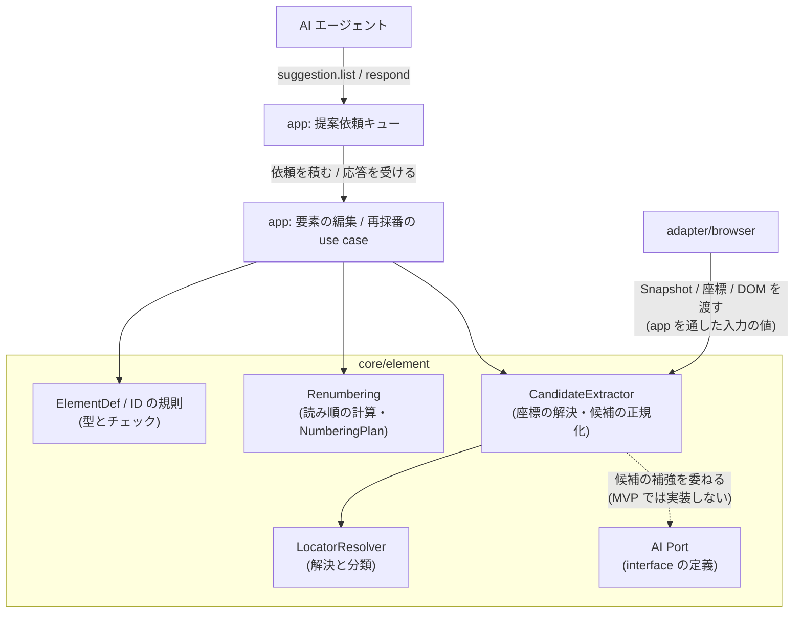
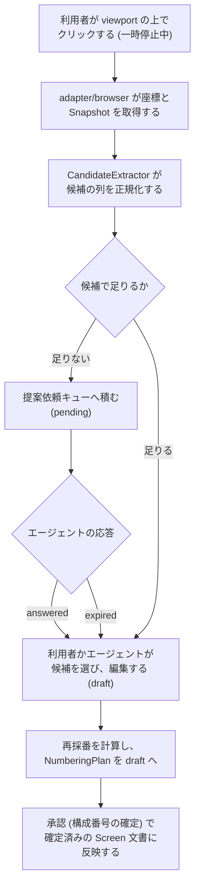

# 画面要素マッピング

## Overview

core/element は、画面の上の実際の要素と、仕様書の要素定義を対応づける。  
この文書は次の 4 つを定める。

- 永続要素 ID と Locator のモデル。要素の同一性をどう表し、画面の上の実際の要素をどう見つけるか。
- 構成番号の再採番。読み順（左上から右、次に下）で 1..N を計算し、DSL へ書き戻す規則。
- 要素候補の正規化。撮影した Snapshot と DOM の生のデータから、要素定義の候補を作る規則。
- AI Port の契約。要素の名称、種別、Locator の候補の生成を、外部の AI へ委ねるための interface。

同じ要素に違う構成番号や名称が割り当てられることと、画面を変えた後も古い要素定義が残ることを、永続 ID と機械的な採番で防ぐ。  
背景は [PRD の Background](../../PRD.md#background) に、満たす成功の条件は [PRD の Success Metrics](../../PRD.md#success-metrics) にある。  
ADR-0012: [永続要素 ID と表示用の構成番号を分ける](../../adr/0012-element-id-number-separation.md)  
ADR-0005: [構成番号の採番と再採番](../../adr/0005-renumbering.md)

core/element は純粋なロジックで、ブラウザと AI サービスへ直接アクセスしない。  
Snapshot、座標、DOM の情報は入力の値として受け取る。  
AI への問い合わせは、AI Port の背後に置く。  
全体の構成は [Design Doc](../../design/DesignDoc.md#components) にある。

## Scope

持つものは次のとおり。

- 永続要素 ID の規則（一意性、生成、変更の禁止）
- Locator のモデル（Semantic Locator の語彙と優先順位）と、解決の結果の分類
- 要素の種別（type）の語彙（固定の enum と拡張の枠）
- 読み順の導き方と、状態ごとの再採番（`badges` のリストの計算。`optional` と `child_doc` の除外を含む）
- 座標（クリックした位置）から要素候補への解決の規則
- Snapshot と DOM の生のデータからの、要素候補の正規化
- AI Port の契約（入力、出力、draft としての扱い）

持たないものは次のとおり。

- 番号と要素定義を DSL のどこに書くか。[ワークフロー定義](../core-workflow/DesignDoc.md) が持つ。
- Locator の解決の実行時の評価（Expectation の評価）。[実行](../core-execution/DesignDoc.md) が持つ。
- Snapshot、DOM、座標の取得の仕方。adapter/browser が持ち、core/element は入力の値として受け取る。
  - adapter/browser の責務は [Design Doc](../../design/DesignDoc.md#components) にある。
- AI サービスの選定と認証。MVP では扱わない。
  - 候補の生成はエージェントが主導し、`adapter/ai` を実装しない。
  - ADR-0019: [AI 候補生成をエージェント主導にする](../../adr/0019-agent-led-ai-suggestions.md)
- 番号のバッジの描画とテーブルの出力。[成果物の生成](../core-artifact/DesignDoc.md) が持つ。
- 要素の差分の分類（Role の変更、文言の変更など）。[変更の検知](../core-diff/DesignDoc.md) が持つ。

## Design

### データの構造

| 型               | 内容                                                                                             | 備考                                                                  |
| ---------------- | ------------------------------------------------------------------------------------------------ | --------------------------------------------------------------------- |
| ElementDef       | 永続 ID、名称、種別、Locator、初めて現れる状態、表示の区分（badges に載る、optional、child_doc） | 確定済みのデータは Screen 文書が持つ。core/element は型と規則を定める |
| Locator          | Semantic Locator の記述（「Locator のモデル」の節）                                              | 要素定義の中に置く。Expectation からは `ref` を通して参照する         |
| ElementCandidate | 候補の抽出の出力。Locator の候補の列、推定した名称と種別、幾何の情報、由来（Snapshot のノード）  | 正規化してある。draft へ反映するのは利用者かエージェントの操作        |
| NumberingPlan    | 再採番の計算の結果。状態ごとの `badges` の並びと、旧番号との対応表（要素 ID が基準）             | draft として DSL へ書き戻す                                           |
| ResolutionResult | Locator の解決の分類。`resolved`（一意に解決）、`not-found`（未解決）、`ambiguous`（複数が一致） | 分類を使うのは core/execution と core/diff                            |

### 永続要素 ID の規則

- ID は、画面（Screen 文書）の中で一意にする。
  - 形式は、人が読める slug（`el-username` など）を推奨する。
  - Schema は一意性だけを強いる。
- 一度割り当てた ID は変えない。
  - 要素の意味が変わったときは、削除して新しい ID を作る。
  - 版の間の追跡には、別の要素として記録される。
- ID は仕様書に表示しない。
  - 表示は、構成番号と名称が受け持つ。

### Locator のモデル

Semantic Locator を優先する。  
出典: [Design Doc の Assumptions and Constraints](../../design/DesignDoc.md#assumptions-and-constraints)

1 つの Locator は、次の属性の組で表す。

| 属性             | 例                             | 優先順位                                  |
| ---------------- | ------------------------------ | ----------------------------------------- |
| `role` と `name` | `{ role: button, name: 送信 }` | 1（最も優先する）                         |
| `label`          | `{ label: ユーザー名 }`        | 2                                         |
| `testid`         | `{ testid: submit-btn }`       | 3                                         |
| `text`           | `{ text: ログインする }`       | 4                                         |
| `css`            | `{ css: ".footer > a" }`       | 5（最後の手段。候補の生成では提案しない） |

- 解決は、宣言したすべての属性の AND で行う。
  - 結果は `resolved`、`not-found`、`ambiguous` に分類する。
- `index` は、同じ Locator が複数に一致するときの、1 から始まる序数の指定である。
  - 一覧の行の要素のように、Semantic Locator で絞り切れない対象のための、明示的な逃げ道にする。
  - DOM の順に依存して脆いので、絞り込みで解決できないときに限って使う。
- `all` は、該当するすべてを 1 つの要素定義として扱い、同じ構成番号のバッジをすべてに描く。
  - データの件数の分だけ並ぶ、繰り返しの要素に使う。
- `index` と `all` のどちらも指定しない `ambiguous` は、Locator の絞り込み（属性の追加）を促すエラーとして扱う。
- 優先順位の表は既定値で、対象のプロダクトごとの設定で入れ替えられる。
  - `data-testid` を規約として振っているプロダクトでは、testid が最も安定する。文言の変更や i18n で変わらない契約として付けてあるためである。
  - そのプロダクトでは、`testid > role+name > label > …` に変える。
  - 優先順位の設定が影響するのは、候補の生成の提案の順だけである。解決の意味（属性の AND と分類）は変わらない。
  - testid のないプロダクトでは、semantic を優先する既定のまま、候補の生成が一意に解決できる語彙へ自動で寄る。
- agent-browser の一時的な要素の参照（`@e1` など）は、DSL に保存しない。
  - Locator は、毎回の Snapshot に対して解決する。
  - 出典: [Design Doc の Assumptions and Constraints](../../design/DesignDoc.md#assumptions-and-constraints)

### 要素の種別（type）の語彙

種別は、固定の enum と拡張の枠で表す。  
基本の語彙は `input`、`button`、`link`、`text`、`image`、`dialog`、`table`、`list`、`checkbox`、`radio`、`select`、`tab`、`menu` である。  
プロジェクトに固有の種別は、`custom:<名前>` で足す。  
仕様書の表記と差分の判定を安定させるため、自由な文字列は許さない。

### 読み順の導き方と再採番（状態ごと）

構成番号は状態の単位で採番し、state の `badges` の順序のリストだけが番号を表す。  
再採番は、「計算する、draft へ書き戻す、承認する」の操作である。  
ADR-0005: [構成番号の採番と再採番](../../adr/0005-renumbering.md)

計算の規則は次のとおり。

1. 対象を取り出す: その状態に現れる要素（継承の規則を展開した結果）から、`optional` と `child_doc` を除いたバッジの対象を集める。
2. 読み順に並べる: その状態の撮影の結果から、要素の bounding box を取る。y 座標を許容の幅で行のバンドにまとめ、バンドの順、バンドの中では x の昇順に並べる。許容の幅は設定値で、既定は要素の高さの中央値の 1/2 である。
3. 書き戻す: 並びの順を、state の `badges` のリストとして draft に反映する。リストの位置が、そのまま構成番号（1..N）になる。
4. 対応表を作る: 旧の `badges` との差分から、番号の対応表（要素 ID を基準にした旧から新）を作り、差分の成果物に含める。

- 同じ撮影の結果と設定からは、常に同じ並びを出す（決定性）。
- 幾何の情報がない要素（非表示のまま定義したものなど）は、リストの末尾に置き、警告を付ける。
- `all` を指定した要素は、一致したすべてを囲む最小の矩形を、代表の位置にする。
  - `all` は複数の bounding box を持つので、どれを使うかを決めないと、同じ入力でも実装によって並びが変わる。
  - 先頭の一致を使わないのは、DOM の順が読み順と一致する保証がないためである。
  - 一致の件数が 0 のときは、幾何の情報がない要素として扱い、末尾へ置いて警告を付ける。
  - バッジはすべてに描くが（成果物の生成の規則）、採番の位置を決めるのに使うのは、代表の位置の 1 つだけである。
- `badges` の適用は app 層の use case が行う。
  - 承認で構成番号を確定すると、確定済みのデータになる。

### 座標からの要素の解決と、候補の正規化

Web UI での要素の選択（viewport の上のクリック）を、要素候補に変える規則は次のとおり。

1. 入力: クリックの座標と、その時点の Snapshot（Accessibility ツリー、各ノードの bounding box、補助の DOM の情報）。取得は adapter/browser の責務である。
2. 座標を含むノードのうち、操作でき、意味のある role を持つ最小のノードを第一の候補にする。祖先の方向の候補の列も付ける。「ボタンではなくカード全体を選びたい」ときに切り替えるためである。
3. 各候補について、Locator の候補の列を作る。優先順位の設定（既定は role+name、label、testid の順）に従い、その Snapshot の中で一意に解決できるものだけを提案する。一意にならないときは属性を足して絞り込む。それでも曖昧なら、`css` を提案せず、「曖昧」と明示する。
4. 名称と種別の推定: Accessible Name と role から、機械的に初期値を作る。より良い候補が要るときは、AI Port に委ねる。

操作の記録も、同じ規則を使う。  
記録の最中の操作は座標として届くので、上と同じ手順で要素へ解決する。  
ADR-0026: [操作の記録を DSL の draft を書く手段にする](../../adr/0026-operation-recording.md)

要素の選択との違いは、次の 2 点だけである。

- 既存の要素定義に一致すれば、新しい候補を作らず、その `ref` を使う。
  - 記録のたびに、同じ要素を重ねて定義しないようにする。
- 一意な Locator へ解決できないとき、要素の選択ではエラーにするが、記録では `clickPoint` として残して警告を付ける。
  - 記録を途中で止めないためである。

### コンポーネントの構成（C4 L3）

次の図は、core/element の中のコンポーネントと、app 層、adapter/browser、提案依頼キューとの関係を示す。

MVP では AI Port を実装しない。  
候補の補強はエージェント自身の推論で行い、提案依頼キューを通してやり取りする。  
AI Port は型として残すが、`adapter/ai` は作らない。  
ADR-0019: [AI 候補生成をエージェント主導にする](../../adr/0019-agent-led-ai-suggestions.md)  
ADR-0020: [人間起点の提案依頼を pull 型キューで実現する](../../adr/0020-suggestion-pull-queue.md)  
キューの設計は [AI 候補生成](../../design/features/ai-suggestions/DesignDoc.md) にある。

### 処理の流れ（要素の選択から定義の draft まで）

次の図は、利用者が viewport の上で要素を選んでから、要素定義が確定するまでの流れを示す。

候補が足りないときも、手を止めない。  
依頼を積んだうえで、利用者はそのまま手で名付けられる。  
`expired` になっても、同じ導線へ戻る。  
AI がいなくても完結することが要件である。

## Interface

### AI Port の契約

AI Port は core/element が定義する Port である。

| 項目 | 契約                                                                                                                                                |
| ---- | --------------------------------------------------------------------------------------------------------------------------------------------------- |
| 入力 | 対象の要素の Snapshot の断片（Accessibility のノードと周りの文脈）、画面のメタ情報（タイトルと状態の id）、既存の要素定義の一覧（命名を揃えるため） |
| 出力 | 構造化した候補。名称、種別、Locator の候補の列で、それぞれ確信度を持つ。自由な文は返さない                                                          |
| 制約 | 出力は常に draft への提案で、AI Port の実装が DSL を直接変えることはない。AI サービスへ何を送ってよいか（画像と DOM の可否）は、送信の境界に従う    |

ADR-0010: [AI サービスへの送信の境界](../../adr/0010-ai-data-boundary.md)

### チェック

テストの共通の規約は [context/testing.md](../../context/testing.md#test-types-and-guarantees) にある。  
core/element は純粋なロジックで、unit test の主な対象である。  
この機能に固有の観点は次のとおり。

- 読み順の計算: 同じ入力に対する決定性、行のバンドの境界（許容の幅ちょうど、高さの違う要素の混在）、幾何の情報がない要素を末尾に置くこと、`optional` と `child_doc` の除外
- 再採番: 追加、削除、移動のそれぞれで、状態ごとの badges と対応表が正しいこと
- Locator の解決: `resolved`、`not-found`、`ambiguous` の分類、属性の AND の一致の規則、`index` の序数の解決、`all` ですべてを列挙すること
- 候補の抽出: 座標から最小のノードを選ぶこと、祖先の候補の列の順序、一意にならない Locator を提案しないこと
- 提案依頼キュー: 依頼が `pending` で積まれること、応答で `answered` になること、期限を過ぎて `expired` になり、手動の導線へ戻せること
  - エージェントの応答が来なくても、要素定義を作れること
- AI Port: 型としてだけ存在し、MVP に実装はない。
  - テストの対象は、fake の実装での出力の Schema のチェック（自由な文と未知の種別を拒むこと）と、draft の外へ書き込まないことに限る。
