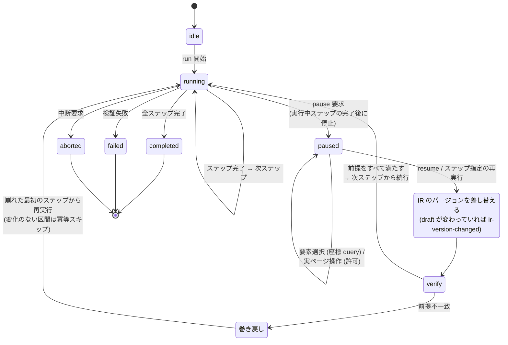
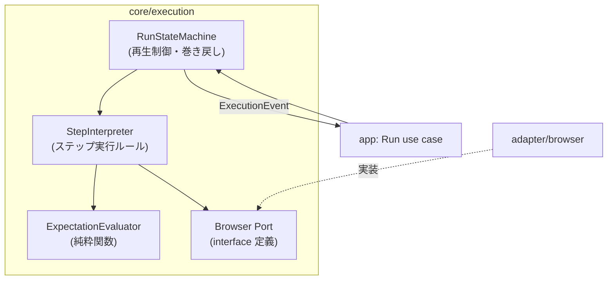
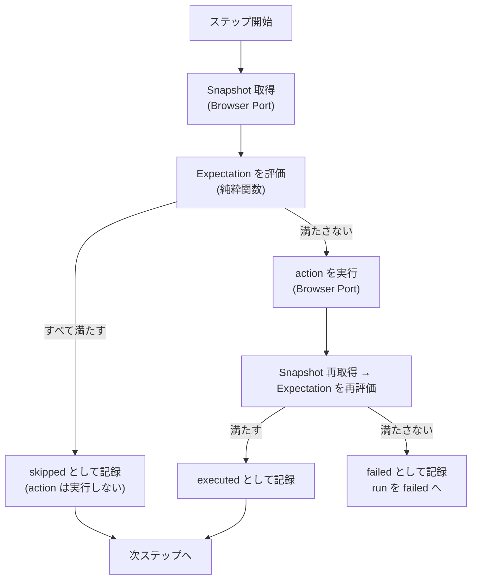

# 冪等実行と再生制御

## Overview

core/execution は、DSL に書かれたステップ列を、ブラウザ上で再現できる形で実行する。  
各ステップは、期待状態を確かめてから操作し、既に満たしていれば操作しない（冪等スキップ）。  
run の状態と、一時停止、再開、巻き戻し、再実行での遷移を持つ。  
ブラウザの操作は Browser Port の背後の agent-browser へ委ね、実行の進行は実行イベントとして UI、エージェント、実行履歴へ伝える。  
満たす成功条件は [PRD の Success Metrics](../../PRD.md#success-metrics) にあり、全体の構成は [Design Doc](../../design/DesignDoc.md#components) にある。  
ADR-0002: [一時停止の意味](../../adr/0002-pause-semantics.md)  
ADR-0013: [ブラウザ実行基盤に agent-browser を使う](../../adr/0013-agent-browser-runtime.md)

Workflow IR は、YAML で書いた DSL を実行しやすい形へ正規化した内部表現である。  
core/workflow が DSL を検証して正規化し、IR を作る。  
core/execution は YAML を直接読まず、IR のうち実行ステップ列（対象の状態への平坦化ビュー）だけを入力に取る。  
IR の構造は [Workflow DSL の Design Doc](../core-workflow/DesignDoc.md) が定める。

## Scope

持つものは次のとおり。

- ステップ実行の規則（期待状態の評価、冪等スキップの判定、操作、検証）
- 実行の状態と遷移（run と step が取る状態、一時停止、再開、巻き戻し、ステップ単位の再実行）
- Browser Port の契約（セッションのライフサイクル、型付きのコマンド、Snapshot とスクリーンショットの取得）
- 実行イベントの語彙と発行の順序。web、agent interface、実行履歴が共通に購読する。
- 実行履歴として永続化する記録の内容の定義。保存そのものは、app が Store Port を通して行う。

持たないものは次のとおり。

- DSL の構文と、期待状態を宣言する語彙。[Workflow DSL の Design Doc](../core-workflow/DesignDoc.md) が持つ。
  - core/execution は正規化した Workflow IR だけを受け取り、YAML を直接扱わない。
- 要素の同一性と採番。[要素の同一性と採番の Design Doc](../core-element/DesignDoc.md) が持つ。
- 成果物の生成。[仕様成果物の生成の Design Doc](../core-artifact/DesignDoc.md) が持つ。
- 差分の検知。[変更差分の検知の Design Doc](../core-diff/DesignDoc.md) が持つ。
- 再生の UI の表現と、ライブ映像の描画。[Web エディタの Design Doc](../../apps/web/DesignDoc.md) が持つ。
- イベントを外へ公開する形式（WebSocket、MCP の notification など）。[agent interface の Design Doc](../agent/DesignDoc.md) が持つ。
- 認証状態の暗号化と、鍵の置き場。[ローカル実行のセキュリティ](../../design/features/local-security/DesignDoc.md#暗号化の契約) が持つ。
- 分散実行と、複数のブラウザでの並列実行。MVP では実装しない。
  - 出典: [PRD の Lower-Priority Goals](../../PRD.md#lower-priority-goals)

## Design

### データ構造

| 型             | 内容                                                                                                                                    | 備考                                           |
| -------------- | --------------------------------------------------------------------------------------------------------------------------------------- | ---------------------------------------------- |
| Run            | 1 回の実行。workflow の参照、固定した IR のバージョン、認証コンテキスト、入力、RunStatus、StepResult の列                               | 実行履歴の単位                                 |
| RunStatus      | `idle → running → paused → (running…) → completed / failed / aborted`                                                                   | 遷移は「実行状態と再生制御」の節にある         |
| Step (IR)      | 操作（action）と期待状態（expectation）の組。core/workflow が正規化して渡す                                                             | core/execution は IR を変更しない              |
| Expectation    | 実行の後に満たされるべき、宣言的な条件の集合                                                                                            | 語彙は core/workflow が定め、評価はここで行う  |
| StepResult     | outcome（`skipped / executed / failed`）、評価した Expectation の結果、実行の前後の Snapshot の参照、スクリーンショットの参照、所要時間 | `skipped` は冪等スキップ（「変更なし」の記録） |
| ExecutionEvent | 実行中に発行するイベント。語彙は「実行イベント」の節にある                                                                              | append-only。順序は決定的                      |

### ステップ実行のルール

各ステップを次の手順で処理する。

1. 評価: 現在の画面の状態に対して Expectation を評価する。
2. 冪等スキップ: すべて満たしていれば、action を実行せず `skipped` として記録する。
3. 実行: 満たしていなければ、action を Browser Port を通して実行する。
4. 検証: 実行の後に Expectation を評価し直す。満たせば `executed`、満たさなければ `failed` として記録し、run を `failed` に遷移させる。

Expectation の評価は、Snapshot（Accessibility ツリーと補助の情報）を入力とする純粋関数として実装する。  
Browser Port は Snapshot の取得までを担う。  
同じ Snapshot に対する評価の結果は、常に同じになる。  
再現性はこの性質に支えられる。

**Expectation を持たないステップは、評価を省いて必ず action を実行する。**  
「すべて満たす」を空集合へそのまま当てはめると常に真になり、action が一度も実行されないまま `skipped` になる。  
空集合は「期待状態を宣言していない」ことを意味し、「既に満たしている」ことを意味しない。

### 実行中は Workflow IR のバージョンを固定する

run は開始時に Workflow IR のバージョンを固定し、実行中は差し替えない。  
固定しないと、途中で要素定義を編集したときにステップ列が入れ替わり、記録した StepResult がどのバージョンに対するものか決まらなくなる。  
ADR-0018: [IR のバージョンの固定](../../adr/0018-ir-version-pinning.md)

バージョンは Schema のバージョンとは別のもので、正規化した IR の内容から決まる値にする。  
編集していなければ同じ値になり、1 文字でも変われば別の値になる。  
run が使った IR は、後から評価の結果を組み立て直せるよう、変更されない形で保存する。

差し替えるのは、`resume` と `rerun_step` の直前だけにする。  
差し替えたときは `ir-version-changed` を発行し、前提の再検証と巻き戻しを通常どおり行う。  
UI はこの差し替えを利用者へ明示する。  
UI の表現は [Web エディタの Design Doc](../../apps/web/DesignDoc.md) にある。

### 実行状態と再生制御

次の図は、run の状態遷移を示す。

- 一時停止は、ステップの境界でだけ止める。
  - pause の要求は、「実行中のステップが完了した後に停止する」予約として扱う。
- 一時停止中の、実際のページの操作を許可する。
  - 要素を選ぶための座標の問い合わせ（Element Inspector への query）は操作に含めず、常に行える。
- 再開するときは、それまでに通過したステップの Expectation を評価し直す。
  - すべて満たしていれば、次のステップから続ける。
  - 満たさないステップがあれば、満たさなくなった最初のステップまで巻き戻して再実行する。冪等スキップがあるため、変わっていない区間は `skipped` で速く通過する。
- 利用者は一時停止中に、通過したステップのどれかを指定して再実行できる。
  - 指定したステップより後の StepResult は無効にし、そこから再生し直す。
- IR のバージョンの差し替えは、再検証の前に行う。
  - 差し替えた後の Expectation で前提を評価しないと、古い IR の期待状態で巻き戻し先を決めることになる。

### Browser Port の契約

Browser Port は core/execution が定義し、adapter/browser が実装する。

| 区分       | 契約                                                                                                                                                                                          |
| ---------- | --------------------------------------------------------------------------------------------------------------------------------------------------------------------------------------------- |
| セッション | `createSession / closeSession / keepalive`。セッションは、ページの状態と要素の参照を保持する第一級の抽象。一時停止中もセッションを生かしておく。keepalive は adapter の責務として契約に含める |
| 認証       | `createSession` は認証コンテキストを必須の引数で受ける。Storage State の復号と注入は adapter/browser の責務                                                                                   |
| コマンド   | 型付きの action の実行。CLI と SDK の呼び出しの形式と JSON の解析は adapter の中に閉じ、Port は型付きの結果だけを返す                                                                         |
| 取得       | Snapshot（Accessibility ツリー）、スクリーンショット（バイナリの参照）、現在の URL などの状態の取得                                                                                           |
| 配信       | ライブ映像のストリームのハンドルの取得。描画は web、転送は adapter/browser の責務                                                                                                             |

ADR-0022: [認証状態の保存](../../adr/0022-auth-state-storage.md)

認証コンテキストを省略できる引数にしない。  
省略できると「認証なし」が既定になり、意図しないプロファイルでの実行と、Baseline の汚染を招く。  
認証しない場合も、匿名であることを明示する。

**復号した Storage State を core と app へ渡さない。**  
Port が受け取るのはプロファイルの名前だけで、実体の復号と注入は adapter に閉じる。  
取り込みと暗号化の契約は [ローカル実行のセキュリティ](../../design/features/local-security/DesignDoc.md#認証状態の取り込みと失効) にある。

構造化エラーの語彙に `auth/expired` を持つ。  
認証状態が失効したときに、呼び出し側が「取り込み直しを促す」判断を機械的に行えるようにするためである。

#### `auth/expired` を返す条件

サーバー側の失効や SSO の期限切れは、ログイン画面への遷移として現れる。  
この遷移は、通常の画面の改修や Locator の解決の失敗と見分けがつかない。  
そのため、**失敗したというだけで `auth/expired` を返さない。**  
ADR-0022: [認証状態の保存](../../adr/0022-auth-state-storage.md)

認証プロファイルごとに「認証済みであることの検証条件」を宣言し、run の開始時に評価する。  
条件は Expectation と同じ語彙で書き、新しい語彙を増やさない。

| 状況                                   | 返すもの                                                |
| -------------------------------------- | ------------------------------------------------------- |
| 検証条件を満たさない                   | `auth/expired`                                          |
| 検証条件を宣言していない               | `auth/expired` と決めつけず、通常の実行の失敗として返す |
| 検証条件を満たすが、後の操作が失敗する | 通常の実行の失敗として返す                              |

誤って `auth/expired` を返すと、利用者は画面を改修するたびに認証を取り込み直すことになる。  
決められないときは `auth/expired` を返さない方を選ぶ。

#### agent-browser の呼び出し

adapter/browser は、`packages/adapter-browser` に npm の依存として宣言した agent-browser の CLI を、run の実行時に子プロセスとして呼ぶ。  
ADR-0027: [agent-browser を npm 依存として同梱しブラウザは起動時に確かめる](../../adr/0027-agent-browser-bundling.md)

- 呼び出しには `--json` を付け、引数は配列で渡す。文字列を連結してシェルに解釈させない。
- daemon は、CLI が最初のコマンドで自動で起動する。adapter/browser は daemon を明示的に終了させない。
- ブラウザの本体の有無は、Workflow Server の起動時に確かめる。チェックは [context/operations.md](../../context/operations.md#health-and-monitoring) にある。

### コンポーネントの構成

次の図は、core/execution の内部の構成要素と、app と adapter/browser とのつながりの L3 を示す。

### 1 ステップの処理の流れ

次の図は、1 つのステップを評価、冪等スキップ、実行、検証の順で処理する流れを示す。

### 実行イベント

実行イベントは、発行の順序が決定的な append-only の列である。  
web（再生の表示の同期）、agent interface（エージェントへの通知）、実行履歴（永続化）が、同じ列を購読する。

イベントの語彙は次のとおり。

- run: `run-started`、`run-completed`、`run-failed`、`run-aborted`
- step: `step-started`、`expectation-evaluated`、`step-skipped`、`step-executed`、`step-failed`
- 再生制御: `paused`、`ir-version-changed`、`resumed`、`rolled-back`

イベントには、step の id、Expectation の評価の結果、Snapshot とスクリーンショットの参照を含める。  
UI が注釈の表示に要る情報を、イベントだけで組み立てられるようにするためである。

`ir-version-changed` は、`resume` と `rerun_step` で IR のバージョンを差し替えたときに発行し、差し替えの前と後のバージョンを含める。  
イベントの列だけを読んで、どのステップがどのバージョンに対する結果かを見分けられるようにするためである。  
ADR-0018: [IR のバージョンの固定](../../adr/0018-ir-version-pinning.md)

**秘密情報をイベントへ入れない。**  
入力の値のうち secret に指定したものは、イベント、StepResult、ログのどれでも伏せる。  
実行履歴は永続化されるため、一度入ると後から取り除けない。  
secret の指定の書き方は [Workflow DSL の Design Doc](../core-workflow/DesignDoc.md) にあり、値の置き場は [ローカル実行のセキュリティ](../../design/features/local-security/DesignDoc.md#dsl-が参照する-secret) にある。

## Interface

### 外へ見せるもの

- Browser Port: adapter/browser が実装する。契約は「Browser Port の契約」の節にある。
- 構造化エラーの `auth/expired`: 返す条件は「`auth/expired` を返す条件」の節にある。
- ExecutionEvent の列: app を通して web、agent interface、実行履歴へ渡る。語彙は「実行イベント」の節にある。
- Run と StepResult: 実行履歴として永続化する記録の内容。保存は app が Store Port を通して行う。

### チェック

テストの共通の規約は [context/testing.md](../../context/testing.md) にある。  
core/execution は、純粋なロジックとして unit テストの主な対象にする。  
この機能に固有の観点は次のとおり。

- ExpectationEvaluator: 同じ Snapshot の入力に対して評価が決定的であること。満たす、満たさない、評価できない（Locator が解決できない）の分岐。
- 冪等スキップの判定: 満たしているときに action が呼ばれないこと。fake の Browser Port で確かめる。
- 状態遷移: pause の予約がステップの境界まで遅れること。resume のときの巻き戻し先の決定（満たさないステップが複数あれば最初のステップ）。
- ステップの再実行: 指定したステップより後の StepResult の無効化と、イベントとの整合。
- イベント: 発行の順序が決定的であること。履歴から run を組み立て直せること。
- IR のバージョンの固定: 実行中に draft を編集しても、実行中の run のステップ列が変わらないこと。`resume` で差し替わったときに `ir-version-changed` が発行され、その後の再検証が新しいバージョンで行われること。
- 認証: `createSession` に認証コンテキストが必ず渡ること。失効したときに `auth/expired` の構造化エラーが返ること。
- Expectation を持たないステップが `skipped` にならず、必ず実行されること。
- secret に指定した入力の値が、StepResult、イベント、ログのどれにも現れないこと。
