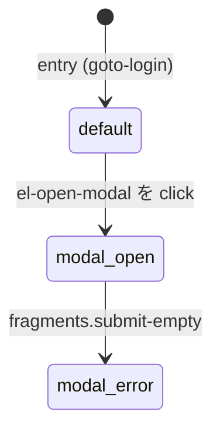
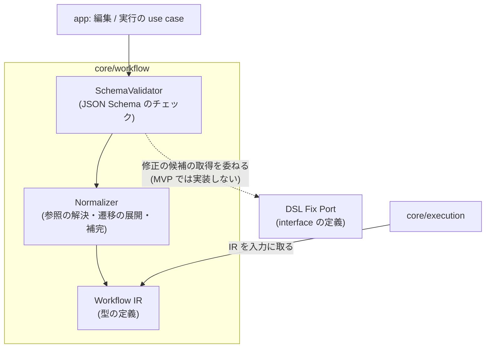
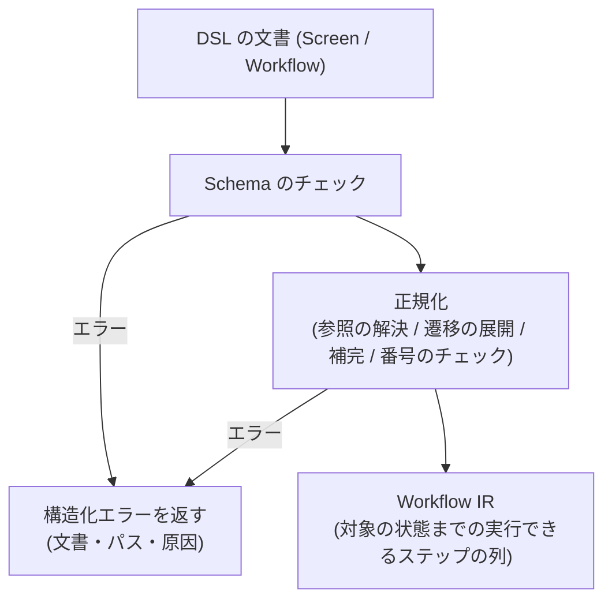

# ワークフロー定義

## Overview

core/workflow は、利用者とエージェントが書いた YAML の DSL を、実行と成果物の生成が読む唯一の元データにする。  
ADR-0011: [YAML DSL を画面操作と画面仕様の唯一の元データにする](../../adr/0011-dsl-as-source-of-truth.md)

この文書は次の 4 つを定める。

- DSL の文書の構造。Screen（画面）と Workflow（操作列）の 2 種類の文書と、その関係。
- Expectation の語彙。「画面がこの状態であるべき」を宣言する条件の種類。
- Workflow IR への正規化。YAML を、実行しやすい内部の表現（IR）に変える規則。
- Schema によるチェックとバージョン。不正な DSL を実行の前に弾く仕組みと、DSL のバージョンの管理。

Screen は画面仕様書を生成する単位で、1 画面が 1 文書と 1 仕様書に当たる。  
Screen は要素定義と構成番号を持つ。  
Workflow は、画面に到達する操作列と、画面をまたぐ操作列である。  
Screen は Workflow を参照して再利用する。  
ADR-0003: [DSL を Screen と Workflow の 2 文書に分離する](../../adr/0003-dsl-structure.md)

DSL は機械が読め、部分を編集しても安全な構造にする。  
AI エージェントが draft として自由に作り、編集するためである。  
この文書が満たす成功の条件は [PRD の Success Metrics](../../PRD.md#success-metrics) にある。  
全体の構成は [Design Doc](../../design/DesignDoc.md#components) にある。

## Scope

持つものは次のとおり。

- Screen 文書と Workflow 文書の構造（項目、参照の関係、記述の例）
- 画面の状態（state）と、状態を遷移させる step の宣言の仕方
- 要素定義を書く場所と、構成番号と番号なしの要素の書き方
  - 読み順の再採番で欠番を作らない。
  - ADR-0005: [構成番号の採番と再採番](../../adr/0005-renumbering.md)
- Expectation の語彙（MVP の条件の組）
- Workflow IR への正規化の規則（参照の解決、状態遷移の展開、既定値の補完）
- JSON Schema によるチェックと、`version` フィールドによるバージョンの管理

持たないものは次のとおり。

- Expectation の評価と実行。[実行](../core-execution/DesignDoc.md) が持つ。
- Locator の解決、要素の同一性の判定、採番の規則の詳細。[画面要素マッピング](../core-element/DesignDoc.md) が持つ。
  - DSL は、それらを「どこに書くか」だけを定める。
- 成果物のレイアウト。[成果物の生成](../core-artifact/DesignDoc.md) が持つ。
- DSL を編集する UI。[Web エディタ](../../apps/web/DesignDoc.md) が持つ。
- 複数の画面をまたぐ検証シナリオの実行。
  - MVP では、Workflow の参照を、画面への到達の再利用に限る。

## Design

### 文書の構造: Screen と Workflow を分ける

DSL は 2 種類の文書からなる。

| 文書     | 単位                  | 持つもの                                                                   | 成果物との関係                                                |
| -------- | --------------------- | -------------------------------------------------------------------------- | ------------------------------------------------------------- |
| Screen   | 1 画面 = 1 ファイル   | 到達の手順（Workflow の参照）、画面の状態と遷移の step、要素定義、構成番号 | 画面仕様書（注釈つきの画像とテーブル）を生成する単位          |
| Workflow | 1 操作列 = 1 ファイル | ステップの列（action と expectation）                                      | 単体では成果物を生成しない。Screen から参照して再利用する単位 |

2 つの文書を分けたうえで、状態を遷移させる step は Screen の側にも持つ。  
「モーダルを開いた状態」のような画面の中の状態は、その画面の関心事である。  
画面の中の状態は、Screen 文書の中だけで宣言を完結させる。

#### Workflow 文書の要素参照

Workflow 文書は要素定義を持たない。  
`click`、`fill`、`hover`、`scroll` は `ref`（要素 ID）を取るので、Workflow の側で参照先の解決元を決める必要がある。

解決元は、その Workflow を参照する Screen 文書の要素定義とする。  
Workflow は、`screen` 引数で受け取った Screen の名前空間で `ref` を解決する。

```yaml
version: 1
workflow:
  id: open-settings
  params:
    screen: { type: screen } # 呼び出し側が渡す Screen。ref はこの名前空間で解決する
  steps:
    - action: { click: { ref: el-settings } }
```

解決できない `ref` は、正規化の時点で `ref/unresolved` の構造化エラーにする。  
実行の時まで持ち越さない。

`open` だけを使う Workflow は、要素を参照しないので、`params` を省いてよい。

#### 認証は DSL に書かない

DSL は元データとしてリポジトリに commit する。  
ADR-0011: [YAML DSL を画面操作と画面仕様の唯一の元データにする](../../adr/0011-dsl-as-source-of-truth.md)

認証プロファイルは run の実行時のパラメータとし、DSL には一切書かない。  
書かないので、同じ Screen 文書を複数の認証プロファイルで実行できる。  
権限ごとに文書を複製しなくて済む。  
ADR-0022: [認証状態の保持と実行時の指定](../../adr/0022-auth-state-storage.md)

#### 入力値を secret で指定する

`fill` の値を DSL に直接書くと、ログインフォームや API キーの入力欄の資格情報が平文で commit される。  
その値は、実行のイベントとログにも残る。  
値を DSL に持たない指定を用意する。

```yaml
- action:
    fill:
      ref: el-password
      secret: login-password # 値は DSL に持たず、実行時に名前で解決する
```

- `secret` で指定した値は、StepResult、ExecutionEvent、ログ、成果物のどれでも伏せる。
  - 実行の履歴は永続化するので、一度入ると後から取り除けない。
- 解決先の置き場と扱いは、[ローカル実行のセキュリティ](../../design/features/local-security/DesignDoc.md#dsl-が参照する-secret) に従う。
- `value` と `secret` は、同時に書けないようにする。
  - 両方を書けると、読み手はどちらが使われるかを決められない。

#### DSL を書く手段

DSL を書く手段は 3 つある。  
どの手段も出力は draft で、確定済みのデータは DSL のまま変わらない。  
ADR-0011: [YAML DSL を画面操作と画面仕様の唯一の元データにする](../../adr/0011-dsl-as-source-of-truth.md)

| 手段                | 誰が                     | 出力                     |
| ------------------- | ------------------------ | ------------------------ |
| YAML を直接書く     | 人                       | draft                    |
| `screen.save_draft` | エージェント             | draft                    |
| 操作の記録          | 人（ブラウザを操作する） | steps と要素定義の draft |

操作の記録は、座標をそのまま残さない。  
Semantic Locator を持つ要素定義へ解決してから steps にする。  
ADR-0026: [操作の記録を DSL の draft を書く手段にする](../../adr/0026-operation-recording.md)

次の Screen 文書の例は、構造を示すための抜粋である。

```yaml
version: 1
screen:
  id: login
  title: ログイン画面
  entry: # この画面に到達する手順。Workflow を参照する
    workflow: goto-login
  states:
    - id: default # 到達直後の状態。遷移 step を持たない
      expect:
        - url: { path: /login }
        - element: { ref: el-username, visible: true }
      badges: [el-username, el-submit] # バッジ対象と順序。リスト位置 = 構成番号 (1, 2)
    - id: modal-open # 画面内の別状態
      from: default # 遷移元の状態
      steps: # 遷移元からこの状態に至る操作列
        - action: { click: { ref: el-open-modal } }
      expect:
        - element: { ref: el-modal, visible: true }
      clip: { css: ".v-overlay__content" } # 撮影領域 (省略時は viewport 全体)
      mask: [{ css: ".updated-at" }] # 画像差分から除外する動的領域 (任意)
      badges: [el-modal, el-modal-submit]
    - id: modal-error # ネストした状態 (モーダルを開いた状態でのエラートースト)
      from: modal-open # ネストは from の連鎖で表す
      steps:
        - use: submit-empty # 名前付き step 断片の参照
      expect:
        - element: { ref: el-toast, visible: true }
      clip: { css: ".v-overlay__content" }
      badges: [el-modal-submit, el-toast] # 状態ごとに 1 から振り直す
  fragments: # 画面内で再利用する名前付き step 断片
    submit-empty:
      - action: { click: { ref: el-modal-submit } }
  elements:
    - id: el-username # 永続要素 ID (画面内で一意。変更しない)
      name: ユーザー名入力
      type: input
      locator: { role: textbox, name: ユーザー名 }
    - id: el-modal
      name: 設定モーダル
      type: dialog
      locator: { role: dialog }
      states: [modal-open] # 初出の状態だけ書く。子孫状態へは継承される
    - id: el-toast
      name: エラートースト
      type: text
      locator: { role: alert }
      states: [modal-error]
    - id: el-username-error
      name: ユーザー名の入力チェックエラー文言
      type: text
      optional: true # 条件付き表示。バッジは付かず、テーブルに番号 - で載る
      note: 未入力のまま送信したときだけ表示
    - id: el-settings-dialog
      name: 設定ダイアログ
      type: dialog
      child_doc: settings-dialog # 別文書化した Screen への参照。テーブルではリンク行になる
```

state の `badges` は、その状態でバッジを付ける要素の順序のリストである。  
リストの位置が、そのまま構成番号になる（先頭が 1）。  
要素定義は番号を持たない。  
番号、表示の順、バッジの対象の 3 つは、`badges` だけが表す。  
採番は状態の単位で行うので、上の例の `el-modal-submit` は、`modal-open` では 2、`modal-error` では 1 になる。  
リストは、再採番の操作が読み順で書き戻すほか、手で並べ替えてもよい。  
ADR-0005: [構成番号の採番と再採番](../../adr/0005-renumbering.md)

次の Workflow 文書の例は、ログイン画面を開いて URL を確かめる。

```yaml
version: 1
workflow:
  id: goto-login
  steps:
    - action: { open: { url: "{{ base_url }}/login" } }
      expect:
        - url: { path: /login }
```

### 状態のモデル: default を根とする木

画面の状態は、`default` を根とする木として宣言する。  
ADR-0004: [画面状態を default 根の木で表す](../../adr/0004-state-model.md)

次の図は、上の Screen 文書の例が表す状態の木を示す。



- `default` は entry が終わった直後の状態で、遷移の step を持たない。
- `default` 以外の状態は、`from`（遷移元）と `steps`（遷移の手順）を必ず持つ。
  - 遷移元をたどると、必ず `default` に着く。
  - 循環と孤立は、Schema のチェックの後の正規化でチェックする。
- ネストした状態は、`from` の連鎖の深さで表す（`default → modal-open → modal-error`）。
  - 例はモーダルを開いた状態でのエラートーストである。
  - 入れ子の専用の構文は持たない。
- 直交する軸の組み合わせ（モーダルとトーストなど）を自動で合成する演算は持たない。
  - 仕様書に載せる状態は、木のノードとして明示的に列挙する。
- 状態遷移の step の語彙は、Workflow の step と同じである。
  - 書ける場所が違うだけで、実行の時は同じ IR のステップになる。

状態は、遷移元（`from`）の状態に現れる要素をすべて継承する。  
`elements` の `states` には、要素が初めて現れる状態だけを書けばよい。  
その子孫の状態には、自動で引き継ぐ。  
モーダルは画面の上に要素を足すという UI の実際に合わせるためである。  
子孫の状態で消える要素は、`hidden-in: [<state>]` で除外を宣言する。

複数の状態遷移で同じ操作列を使うときは、画面の中に名前付きの step の断片（`fragments`）を定義し、`use` で参照する。  
参照の解決は、entry の Workflow の参照と同じ仕組みで行う。  
断片は単なる展開で、状態の意味には影響しない。

### action の語彙（MVP）

| action       | 内容                                                                                          |
| ------------ | --------------------------------------------------------------------------------------------- |
| `open`       | URL を開く                                                                                    |
| `click`      | `ref`（要素 ID）で指す要素をクリックする                                                      |
| `clickPoint` | viewport の座標をクリックする。canvas の描画のように DOM に現れない対象だけに使い、乱用しない |
| `fill`       | `ref` で指す入力要素へ値を入力する                                                            |
| `hover`      | `ref` で指す要素にポインタを重ねる                                                            |
| `scroll`     | `ref` で指す要素を、見える位置までスクロールする                                              |
| `use`        | 名前付きの step の断片を展開する                                                              |

任意の JS の実行（`eval`）は語彙に入れない。  
[PRD の Non-Goals](../../PRD.md#non-goals) に当たる。  
ADR-0003: [DSL を Screen と Workflow の 2 文書に分離する](../../adr/0003-dsl-structure.md)

実行とチェックの仕方は、[実行](../core-execution/DesignDoc.md) が定める。  
固定時間の wait は語彙に持たず、Expectation が満たされるのを待つことで代える。

### 要素定義と構成番号の書き方

- 要素 ID（`id`）は、画面の中で一意の、永続する識別子である。
  - 要素の同一性の判定と、バージョンの間と状態の間の追跡に使う。
  - 変更しない。
- 構成番号は、状態の単位で 1 から採番する。
  - state の `badges` の順序のリストだけが番号を表す（リストの位置が番号）。
  - 要素定義に `number` フィールドは持たない。
  - 再採番は、システムが読み順でリストを並べ直し、DSL へ書き戻す操作である。手で編集してもよい。
  - ADR-0005: [構成番号の採番と再採番](../../adr/0005-renumbering.md)
- 要素の表示の区分は 3 つ。
  - `badges` に載る要素。バッジと番号の行が付く。
  - `optional: true` の、条件つきで表示する要素。バッジは付かず、テーブルに番号 `-` と `note` で載る。実装していない要素には `unimplemented: true` を併記する。
  - どちらにも当たらない補助の要素。テーブルに載せない。
  - どの区分の要素も、`ref` の参照（Locator、Expectation、操作の対象）には使える。
- `child_doc` は、別の文書にした Screen への参照である。
  - バッジは付かず、テーブルでは番号なしのリンクの行になる。
- state の `clip` は撮影する領域、`mask` は画像の差分から除外する動的な領域（日時の表示など）を宣言する。
  - `mask` の適用の規則は、[変更の検知](../core-diff/DesignDoc.md) が持つ。
  - ADR-0007: [画像差分の判定](../../adr/0007-visual-diff.md)

### Expectation の語彙（MVP）

| 条件      | 内容                                                       |
| --------- | ---------------------------------------------------------- |
| `url`     | path と query の一致                                       |
| `title`   | ページのタイトルの一致                                     |
| `element` | `ref`（要素 ID）で指す要素の存在、可視性、テキスト、入力値 |
| `count`   | Locator に一致する要素の数                                 |

- `element` の条件は要素 ID で参照し、Locator を直接書かない。
  - Locator は要素定義だけに書く。
- 語彙を足すときは、`version` の互換の規則に従う。
  - 互換の規則は、この文書の「Schema によるチェックとバージョン」の節にある。
- 評価の仕方は、[実行](../core-execution/DesignDoc.md) が定める。

### Workflow IR への正規化

IR は、チェック、参照の解決、継承の展開を終えた、正規化したモデルである。  
IR は、使う側に応じた 2 つのビューを持つ。  
どちらも core/workflow が生成する。

| ビュー             | 内容                                                                                                                 | 主に使う側                                      |
| ------------------ | -------------------------------------------------------------------------------------------------------------------- | ----------------------------------------------- |
| Screen IR          | 画面全体の正規化したモデル（状態の木、すべての要素定義、状態ごとの要素の集合と badges、entry と遷移の steps の由来） | core/artifact（仕様書と POM の生成）、core/diff |
| 実行のステップの列 | 対象の画面の状態に至るステップの列を平らにしたビュー（Screen IR から導く）                                           | core/execution                                  |

正規化は、次の順で行う。

1. Schema のチェック: JSON Schema で、構文と型をチェックする。
2. 参照の解決: `entry.workflow` の Workflow の参照、`use` の断片の参照、`ref` の要素の参照を解決する。解決できない参照はエラーにする。
3. 継承と遷移の展開: 各状態に現れる要素の集合を、継承の規則（`states` と `hidden-in`）から決め、Screen IR を組み立てる。実行の時は、対象の状態に至るステップの列を `entry → default → … → 対象の状態` の順で平らにする（実行のステップの列）。
4. 既定値の補完と変数の展開: 省いた項目の既定値と、`{{ base_url }}` などの入力の変数を決める。
5. ID と badges のチェック: 要素 ID の一意性、`badges` の参照の解決と重複をチェックする。その状態に現れない要素（継承の規則の外）と、`optional` と `child_doc` の要素が `badges` に載っている矛盾もチェックする。

IR のステップは、action、expectation、由来（どの文書のどの宣言から来たか）を持つ。  
由来があるので、実行のイベントや差分から、DSL の該当する箇所を逆に引ける。

#### 展開を必ず止める

`fragments` の `use` と Workflow の参照は、入れ子にできる。  
断片が自分自身を参照したり、互いを参照したりすると、展開が終わらない。  
エージェントも利用者も draft を自由に書けるので、不正な参照は必ず入るものとして扱う。

| チェック               | 内容                                                                     |
| ---------------------- | ------------------------------------------------------------------------ |
| 循環する参照           | 参照のたどり方をグラフとして持ち、自己参照と相互参照を展開の前に見つける |
| 入れ子の深さ           | 上限を設ける。超えたらエラーにする                                       |
| 展開した後のステップ数 | 上限を設ける。循環していなくても、多段の展開で件数が急に増えることがある |

どれも `ref/cyclic`、`ref/too-deep`、`ref/too-many-steps` の構造化エラーで返す。  
「重いので止まった」ではなく、「規則に反している」として返す。  
エージェントが自分で直せる形にするためである。  
先に決めるのは「上限を持つ」という契約で、数値ではない。

### Schema によるチェックとバージョン

- Schema は JSON Schema として core/workflow が持つ。
  - DSL の文書の `version` フィールドで、対応するバージョンを選ぶ。
- 互換の規則は次のとおり。
  - 語彙の追加は、マイナーの互換とする。古い文書はそのまま読める。
  - 構造の変更は、メジャーバージョンを上げる。古いバージョンの読み込みは、正規化の時の変換で吸収する。

### コンポーネントの構成（C4 L3）

次の図は、core/workflow の中のコンポーネントと、それを呼ぶ側と使う側を示す。



### 処理の流れ（DSL から IR へ）

次の図は、DSL の文書がチェックと正規化を経て Workflow IR になるまでの流れを示す。



## Interface

### エラーの形式

- チェックのエラーは、文書の名前、パス、原因を構造化して返す。
- エラーは、人が読む文言と、機械が読むコードの両方を持つ。
  - エージェントが、コードを読んで自分で直すのに使う。

### DSL Fix Port の契約

DSL Fix Port は core/workflow が定義する Port で、チェックのエラーから修正の候補を得るために使う。

| 項目 | 契約                                                                               |
| ---- | ---------------------------------------------------------------------------------- |
| 入力 | 構造化エラー（`code`、`path`、`message`）と、該当する箇所の正規化の前の DSL の断片 |
| 出力 | 修正した DSL の断片の候補の列。自由な文は返させない（Schema で構造を強いる）       |
| 制約 | draft にだけ作用する。確定済みのデータの書き換えも、自動の適用も行わない           |

MVP では DSL Fix Port を実装しない。  
エラーの構造化コードを読んでエージェントが自分で直す流れを主な動線とし、Port は型としてだけ残す。  
ADR-0019: [AI 候補生成をエージェント主導にする](../../adr/0019-agent-led-ai-suggestions.md)

### チェック

テストの共通の規約は [context/testing.md](../../context/testing.md#test-types-and-guarantees) にある。  
core/workflow は純粋なロジックで、unit test の主な対象である。  
この機能に固有の観点は次のとおり。

- Schema のチェック: 正常な文書、型の不一致、必須の項目の欠落、未知の version
- 正規化: 参照の解決（正常と未解決）、状態遷移の展開の順序、循環と孤立した状態の検出、badges の重複と載せ方の矛盾の検出
- 決定性: 同じ文書と入力から、常に同じ Screen IR と実行のステップの列を生成する。IR を比べて確かめる。
- 互換性: 古い version の文書の読み込みが、変換の規則どおりに動く。
